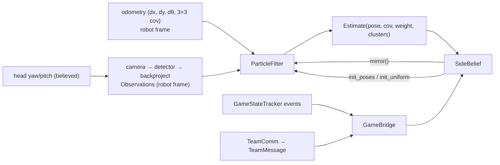

# 02 Architecture

## Class index (definitions)

- `td_field_model/td_field_model/field.py`: [`FieldModel`](../../../td_field_model/td_field_model/field.py), [`LikelihoodField`](../../../td_field_model/td_field_model/field.py)
- `td_field_model/td_field_model/sim.py`: [`CameraModel`](../../../td_field_model/td_field_model/sim.py), [`Observations`](../../../td_field_model/td_field_model/sim.py), [`ObservedLandmark`](../../../td_field_model/td_field_model/sim.py), [`Simulator`](../../../td_field_model/td_field_model/sim.py)
- `td_field_model/td_field_model/scenarios.py`: [`ScenarioBuilder`](../../../td_field_model/td_field_model/scenarios.py), [`Step`](../../../td_field_model/td_field_model/scenarios.py)
- `td_localization/td_localization/pf.py`: [`ParticleFilter`](../../../td_localization/td_localization/pf.py), [`PFConfig`](../../../td_localization/td_localization/pf.py), [`Estimate`](../../../td_localization/td_localization/pf.py), [`UpdateStats`](../../../td_localization/td_localization/pf.py)
- `td_localization/td_localization/side.py`: [`SideBelief`](../../../td_localization/td_localization/side.py), [`SideConfig`](../../../td_localization/td_localization/side.py), [`TeamReport`](../../../td_localization/td_localization/side.py)
- `td_localization/td_localization/game_bridge.py`: [`GameBridge`](../../../td_localization/td_localization/game_bridge.py)
- `td_localization/td_localization/eval.py`: [`EvalConfig`](../../../td_localization/td_localization/eval.py), [`EvalResult`](../../../td_localization/td_localization/eval.py)
- `td_localization/td_localization/suite.py`: [`SimRun`](../../../td_localization/td_localization/suite.py)
- `td_localization/td_localization/team_sim.py`: [`LossyNetwork`](../../../td_localization/td_localization/team_sim.py), [`RobotSpec`](../../../td_localization/td_localization/team_sim.py), [`TeamRun`](../../../td_localization/td_localization/team_sim.py)
- `td_game/td_game/gc_data.py`: [`ControlData`](../../../td_game/td_game/gc_data.py), [`GCFormatError`](../../../td_game/td_game/gc_data.py), [`StatusData`](../../../td_game/td_game/gc_data.py)
- `td_game/td_game/game_state.py`: [`GameEvent`](../../../td_game/td_game/game_state.py), [`GameStateTracker`](../../../td_game/td_game/game_state.py)
- `td_game/td_game/team_msg.py`: [`BudgetPacer`](../../../td_game/td_game/team_msg.py), [`TeamMessage`](../../../td_game/td_game/team_msg.py)
- `td_game/td_game/team_comm.py`: [`TeamComm`](../../../td_game/td_game/team_comm.py)
- `td_game/td_game/udp.py`: [`GameControllerLink`](../../../td_game/td_game/udp.py), [`TeamLink`](../../../td_game/td_game/udp.py)
- `td_bench/td_bench/bench.py`: [`Bench`](../../../td_bench/td_bench/bench.py), [`BenchResult`](../../../td_bench/td_bench/bench.py)
- `td_bench/td_bench/sources.py`: [`World`](../../../td_bench/td_bench/sources.py), [`SimCamera`](../../../td_bench/td_bench/sources.py), [`SimOdometry`](../../../td_bench/td_bench/sources.py), [`SimVisualOdometry`](../../../td_bench/td_bench/sources.py), [`StationaryOdometry`](../../../td_bench/td_bench/sources.py), [`LiveOdometry`](../../../td_bench/td_bench/sources.py), [`LiveVisualOdometry`](../../../td_bench/td_bench/sources.py), [`SimHead`](../../../td_bench/td_bench/sources.py), [`ImuHead`](../../../td_bench/td_bench/sources.py), [`FixedHead`](../../../td_bench/td_bench/sources.py), [`LiveHead`](../../../td_bench/td_bench/sources.py), [`ScriptedGame`](../../../td_bench/td_bench/sources.py), [`UdpGame`](../../../td_bench/td_bench/sources.py), [`SimTeam`](../../../td_bench/td_bench/sources.py), [`UdpTeam`](../../../td_bench/td_bench/sources.py)
- `td_bench/td_bench/vision.py`: [`ImageCamera`](../../../td_bench/td_bench/vision.py), [`SyntheticFrames`](../../../td_bench/td_bench/vision.py), [`FolderFrames`](../../../td_bench/td_bench/vision.py), [`RealSenseFrames`](../../../td_bench/td_bench/vision.py)
- `td_bench/td_bench/record.py`: [`Recorder`](../../../td_bench/td_bench/record.py), [`Recording`](../../../td_bench/td_bench/record.py), [`ReplayCamera`](../../../td_bench/td_bench/record.py), [`ReplayOdometry`](../../../td_bench/td_bench/record.py), [`ReplayHead`](../../../td_bench/td_bench/record.py), [`ReplayGame`](../../../td_bench/td_bench/record.py)

## Data flow

## Per-tick loop

The canonical order, used by `Bench.run` and the future LOC-20 node:

1. `events = game.get(t)` → `bridge.on_events(events)`. Initial/replaced → `side.on_initial`; reentry →
   `side.on_penalty_reentry`; penalized (not in place) → `bridge.paused = True`.
2. `pf.predict(odom, cov)`, skipped on tick 0 and while paused.
3. `pf.update(obs)` if a frame arrived and not paused.
4. `e = pf.estimate()`; `side.step(t, e)` (decay, jump cap, flip). Call exactly once per tick.
5. Optional: `side.on_my_ball(t, to_field(e.pose, rel), sigma)`.
6. Optional: build a `TeamMessage` from `e` and `side.confidence`, send via `TeamComm.outgoing`, and apply received
   messages via `bridge.team_report` → `side.on_team_report`.

Rates in sim/bench: 30 Hz ticks, camera every 2nd tick (15 Hz). Team messages ≤ 2 Hz (budget-paced).

## APIs

### `td_field_model`

| Call | Returns / notes |
|---|---|
| `FieldModel.builtin("hsl_m_2026")`, `.from_json(path)` | Field. `.dims`, `.segments` (17 on M), `.arcs` (5), `.landmarks` (31). |
| `fm.distance(points)` | (N,) distance to the nearest centerline. Exact, slow. |
| `fm.likelihood_field(resolution=0.02)` | `LikelihoodField`: 801×551 grid on M (field + border strip). `.lookup(points)` is bilinear; off-grid returns the grid max. |
| `mirror_pose(x, y, θ)` | `(−x, −y, wrap(θ + π))` |
| `CameraModel(fx, fy, cx, cy, width, height_px, mount_height=1.2, …)` | `.pose_in_base(yaw, pitch)` → `(R, t)`, optical frame in `base_footprint`. |
| `backproject_pixels(cam, uv, R, t)` | `(points (N, 2), hit mask)`: pixel → floor. |
| `project_floor(cam, pts, R, t)` | `(uv (N, 2), visible mask)`: floor → pixel. |
| `floor_covariances(cam, pts, t, pixel_σ, pitch_σ, yaw_σ)` | (N, 2, 2). σ_r = (h² + d²)/h · σ_pitch; σ_t = √(h² + d²) · σ_yaw. |
| `Simulator(fm, camera=None, noise=None, seed=0).render(pose, yaw, pitch, obstacles=(), t=0)` | `Observations`: projects with the true pose, backprojects with the believed pose (bias + jitter). |
| `ScenarioBuilder(fm, seed, dt=1/30, odom_noise, head).start(pose, known_poses).walk(s).turn(a).stand(s).fall().kidnap(pose).penalty_reentry("left"/"right").steps` | `list[Step]` (`t, true_pose, odom, odom_cov, head_yaw, head_pitch, event, known_poses`). Events: initial, fall, kidnap, penalty_reentry. |

### `td_localization`

| Call | Notes |
|---|---|
| `ParticleFilter(fm, likelihood=None, config=None, seed=0)` | Note the arg order: pass `config=` by keyword. |
| `.init_poses(poses, sigma_xy=0.15, sigma_theta=0.1)` | Clouds around the candidates; sets `side_reference` to their centroid. |
| `.init_uniform(own_half_only=True)` | Lost mode: 3000 particles, folded to x ≤ 0. |
| `.predict(odom, odom_cov)` | Robot-frame increment; σ = √diag · 1.5 ⊕ 0.003. |
| `.update(obs) -> UpdateStats` | `n_points, n_landmarks, ess, quality, injected, resampled, drift`. Skipped if < 10 points and no landmarks. |
| `.estimate(update_reference=True) -> Estimate` | Heaviest cluster with hysteresis; may move `side_reference`. |
| `.lost`, `.degraded`, `.drift`, `.ess`, `.side_reference`, `.mirror()` | `mirror()` is for `SideBelief` only. |
| `SideBelief(pf, config=None)` | `.confidence`, `.avoid_shooting` (< 0.9), `.logodds`, `.flips`, `.events`. |
| `.on_initial(t, known_poses or None)`, `.on_penalty_reentry(t, candidates)` | Re-seed, ℓ = 6, 2 s grace. |
| `.on_my_ball(t, xy_field, σ)` | Ignored unless the pose is trustworthy. Keeps a 4 s history. |
| `.on_team_report(TeamReport) -> llr` | Matched against my nearest sighting within 3 s, else queued. |
| `.on_opponents_at_set(t, xy_field_list)` | ±0.5 per opponent beyond ±0.5 m. Not wired to a detector yet. |
| `.step(t, estimate) -> flipped` | Once per tick. |
| `GameBridge(side, fm, start_poses=None, max_ball_age=3.0)` | `.on_events(events)`, `.paused`, `.team_report(t, TeamMessage) -> TeamReport or None`, `.log`. |
| `evaluate(gt, est, name, cfg=None) -> EvalResult` | `.metrics`, `.events` (convergence), `.checks` (§3.3 targets), `.samples`. |
| `simulate(steps, sim, pf, side, ball=None, teammates=(), seed=0, update_every=2) -> SimRun` | One-robot scenario driver. |
| `run_suite(out_dir, field_name, noise="default" or "harsh", seed=1, only=None)` | Writes the reference-style report. |
| `run_team(fm, lf, specs: list[RobotSpec], noise, …) -> TeamRun` | Multi-robot run over a `LossyNetwork`. |
| `status_of(pf, weight)` | `initializing` (lost) / `uncertain` (degraded, drift, or weight < 0.8) / `localized`. |

### `td_game`

| Call | Notes |
|---|---|
| `parse_control(bytes, accept_monitor=False) -> ControlData` | 158 B, `RGme` v20, little-endian. Raises `GCFormatError`. `build_control` is its inverse (tests). |
| `build_status` / `parse_status` (`StatusData`) | 32 B, `RGrt` v4. Pose in mm, same frame as `map`. |
| `GameStateTracker(team, player, timeout_s=3.0).update(t, ControlData) -> [GameEvent]` | Events: state, initial, half, penalized(in_place), reentry, unpenalized_in_place, replaced, gc_lost/gc_back (via `check_timeout`). Dedup by packet number (u8, forward window < 128). Also `.message_budget`, `.budget_counts`, `.active_teammates`, `.is_goalkeeper`. |
| `TeamMessage(player_number, pose, pose_sigma, side_confidence, ball_xy, ball_sigma, ball_age, is_goalkeeper, fallen, localized)` | `pack` gives 22 B `TDLc` v1; `unpack` raises `ValueError` on anything else. |
| `BudgetPacer(max_rate_hz=2.0, reserve=200, safety=0.9).allow(t, budget, counts, remaining_s, robots)` | Rate = min(2, 0.9·(budget − 200)/remaining/robots); token bucket capped at 1. |
| `remaining_game_seconds(secs_remaining, first_half)` | (secs + 600 if first half) × 1.15 |
| `TeamComm(player).outgoing(...)`, `.incoming(t, payload)`, `.teammates(t)`, `.team_ball(t)` | Transport-agnostic; drops its own echo and foreign formats. |
| `GameControllerLink(control_port=3838, status_port=3939)`, `TeamLink(team, port=10000+team, …)` | UDP sockets; `.poll()`, `.send(...)`, `.close()`. |

### `td_bench`

Sources implement `get(t)`:
- camera → `Observations` or None;
- odometry → `(d, cov)`;
- head → `(yaw, pitch)`;
- game → `[GameEvent]`;
- team → `get(t, my_msg) -> [TeamReport]`;
- ball → `(rel_xy, σ)` or None.

| Input | Simulated | Recorded | Live / real |
|---|---|---|---|
| camera | `SimCamera`, `ImageCamera(SyntheticFrames)` | `ReplayCamera` | `ImageCamera(FolderFrames / RealSenseFrames)` |
| odometry | `SimOdometry`, `SimVisualOdometry` (cuVSLAM model) | `ReplayOdometry` | `StationaryOdometry`, `LiveOdometry.push`, `LiveVisualOdometry.push_pose` |
| head | `SimHead`, `ImuHead` (bias + noise) | `ReplayHead` | `FixedHead`, `LiveHead.push` |
| game | `ScriptedGame` | `ReplayGame` | `UdpGame` |
| team | `SimTeam` | | `UdpTeam` |

`Bench(fm, camera, odometry, head=None, game=None, team=None, ball=None, truth=None, start_poses=None, player=2,
goalkeeper=False, pf_config=None, seed=0, recorder=None).run(duration, dt=1/30, realtime=False) -> BenchResult`.
`truth` may be a `World`, a `Recording`, a fixed pose, or None. With no game source, an `initial` event is injected
at t = 0. `Recorder` → `.npz` (no pickle); replay is bit-exact when the ticks match.

## Data contracts

| Contract | Spec |
|---|---|
| `Observations` | `t`; `line_points` (N, 2) m, robot frame; `line_cov` (N, 2, 2); `line_range_ok` (N,) (False beyond 4 m; unused by the PF); `landmarks: [ObservedLandmark(kind, xy, cov, range_ok, truth_name)]`. Kinds: `L`, `T`, `X`, `center_mark`, `penalty_mark`, `goalpost`. |
| Ground-truth CSV | `timestamp_s,x_m,y_m,theta_rad[,event]`; events ∈ {initial, fall, kidnap, penalty_reentry}; strictly increasing time. |
| Estimate CSV | `timestamp_s,status,x_m,y_m,theta_rad[,side_confidence][,published_s]`; status ∈ {localized, uncertain, initializing, lost}; only the first two are usable. |
| Team message | 22 B: `<4sBBBB3hBB2hBB`: magic `TDLc`, version 1, player, flags (GK=1, fallen=2, localized=4, ball_seen=8), conf·255, x/y cm, θ·1e4, pose σ cm, ball age ·10, ball x/y cm, ball σ cm, reserved. |
| Bench recording | `.npz`: per tick `t, odom, odom_cov, head, truth`; ragged observations via offsets (`pt_off`, `lm_off`); events. |

## Key parameters

**`PFConfig`:**

| Parameter | Default | Role |
|---|---|---|
| `n_particles` / `n_particles_lost` | 500 / 3000 | Particle count |
| `max_points` | 120 | Points per update |
| `point_sigma_floor` | 0.05 m | ⊕ √λmax(cov) per point |
| `line_temperature` | 0.15 | Tempering of the summed Cauchy log-likelihood |
| `odom_noise_scale`, `odom_sigma_floor` | 1.5, 0.003 | Predict noise |
| `resample_ess_fraction` | 0.5 | Resample below this ESS fraction |
| `quality_alpha_slow` / `_fast` | 0.005 / 0.3 | Match-quality EMAs |
| `drop_threshold` | 0.3 | Recovery = clip((drop − 0.3)/0.7) |
| `inject_max_fraction` | 0.1 | Injection at full recovery |
| `roughen_xy`, `roughen_theta` | 0.15 m, 0.08 rad | Roughening at full recovery |
| `proposal_factor` / `lost_proposal_factor` | 40 / 10 | Candidates screened per injected particle |
| `drift_candidates` | 200 | Drift test candidates (σ 0.6 m / 0.25 rad and 1.5 m / 0.6 rad) |
| `drift_margin_per_point` | 0.5 | Per-point log-likelihood gap that counts as a vote |
| `drift_votes` / `drift_window` | 3 / 4 | Votes needed out of recent frames |
| `drift_inject_fraction` | 0.05 | Best local candidates injected when the test fires |
| `cluster_radius`, `cluster_angle` | 0.5 m, 0.5 rad | Clustering |
| `confident_cluster_weight` | 0.8 | May move `side_reference` |
| `reference_jump` / `reference_streak` | 1.5 / 30 | Reference continuity |
| `lost_until_cluster_weight` / `lost_confident_streak` | 0.8 / 15 | Exit from lost mode |
| `fold_heading_scale` | 2.0 m/rad | Pose distance |

**`SideConfig`:**

| Parameter | Default | Role |
|---|---|---|
| `known_placement_logodds` | 6 | After Initial / re-entry |
| `max_logodds` | 8 | Clip |
| `flip_threshold` / `flip_hold` / `flip_refractory` | −4 / 1 s / 3 s | Flip conditions |
| `min_flip_sources` / `flip_sources_window` | **2 / 15 s** | **Team decision** |
| `goalkeeper_weight` | 2 | GK evidence multiplier |
| `report_llr_clip` | 2 | Per report |
| `pose_sigma` | 0.3 m | Per robot, in the ball comparison |
| `match_gate_sigma` | 3 | Gate |
| `min_teammate_confidence` | 0.6 | Weight = (c − 0.6)/0.4 |
| `ball_max_age` / `ball_speed` / `ball_history_s` | 3 s / 1 m/s / 4 s | Time matching |
| `degraded_tau` | 6 s | Decay while lost or degraded |
| `jump_distance` / `jump_heading` / `after_jump_logodds` | 1.5 m / 90° / 1 | Jump cap |
| `post_flip_logodds` / `post_lost_grace` | 3 / 2 s | After flip / grace |
| `min_pose_weight` | 0.8 | My ball accepted |
| `avoid_shooting_below` | 0.9 | Behavior threshold |

**Team-report LLR:**
`(|m + b|² − |m − b|²) / 2v`, with v = σ_m² + σ_b² + 2·0.3². Clipped to ±2; 0 if `min(d²) > 9v`; weighted by
`(c − 0.6)/0.4`, ×2 for the GK. σ_m is widened by `ball_speed · |Δt|`.

**Evaluation (`EvalConfig`):**
- matching tolerance 0.05 s;
- "accurate" = ≤ 0.5 m and ≤ 5°;
- wrong half: `d_mirror < d_true` with 2 m/rad;
- converged: < 0.3 m held 2 s;
- targets: p50 ≤ 0.2 m, p95 ≤ 0.5 m, heading p95 ≤ 5°, no wrong half, every event converges ≤ 10 s.

## Extension points

- **New detector (LOC-17):** output `Observations` (robot frame, per-point covariance); plug in as a bench camera
  source or call `pf.update`.
- **New odometry (LOC-11/15/19):** a source with `get(t) -> (d, cov)`; for an absolute-pose stream, use the
  `LiveVisualOdometry` pattern.
- **ROS node (LOC-20):** wrap the per-tick loop above; keep the libraries ROS-free.
- **New scenario:** add it to `suite.scenarios()`; it then appears in `run_suite` reports.
- **New measured value in the test report:** `show(record_property, name, measured, expected)` in a td_bench test.
