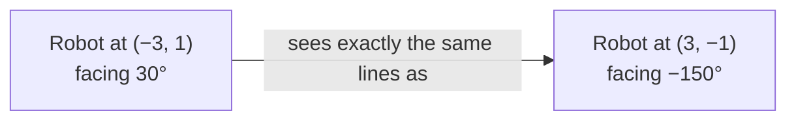
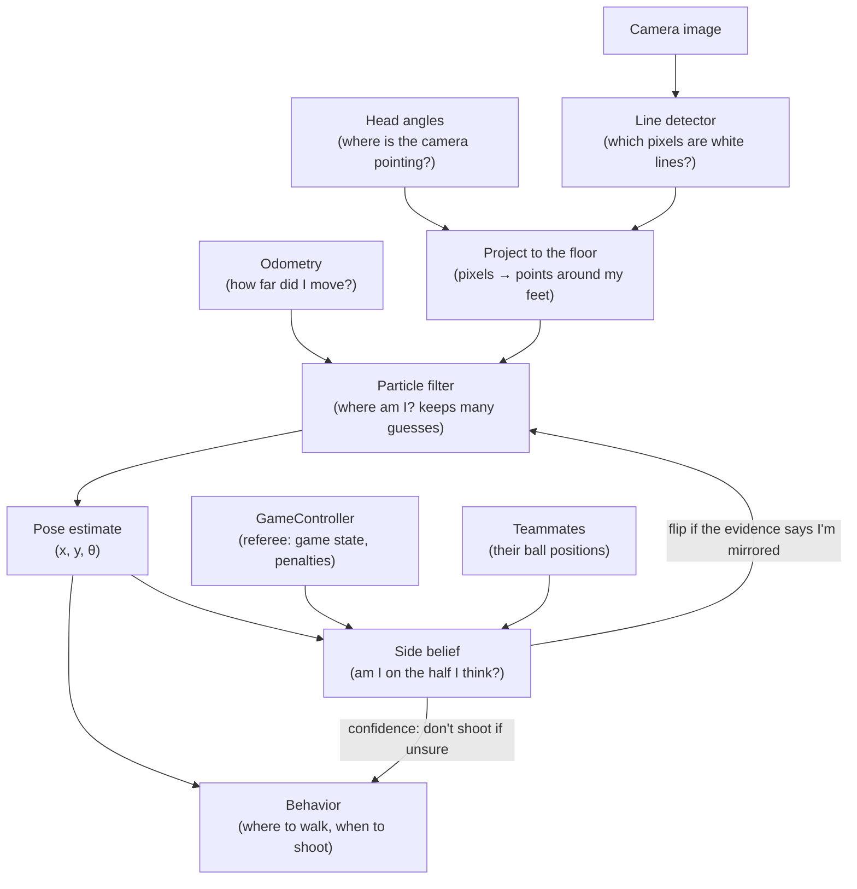

# 1. Welcome

**Series:** [index](../README.md) · **1 Welcome** · [2 Setup](02_setup.md) · [3 Geometry](03_math_geometry.md) ·
[4 Uncertainty](04_math_probability.md) · [5 Field](05_field_model.md) · [6 Camera](06_camera.md) ·
[7 Particle filter](07_particle_filter.md) · [8 Which half](08_side_belief.md) · [9 Game and team](09_game_and_team.md) ·
[10 Testing](10_testing_and_evaluation.md) · [11 Progress](11_progress.md) · [12 Contributing](12_contributing.md)

This series is for anyone joining the localization work, including people who have never written robot software,
never heard of a "particle filter", and haven't done math since high school. Nothing is assumed beyond basic
programming. Every idea is introduced before it's used, every formula is explained in words, and every chapter
ends with something you can run.

By the end of this chapter you'll know:

- what the robot is and what competition it plays in;
- what "localization" means and why a robot needs it;
- why this particular soccer field makes localization unusually tricky;
- how the code is organized, at a very high level;
- the vocabulary used in the rest of the series.

---

## 1.1 The team, the robot and the competition

**Triton Droids** is UC San Diego's humanoid robotics team. The team builds a soccer-playing humanoid robot,
nicknamed **Sparky**, for **RoboCup**: an international competition where robots play soccer on their own. Nobody
steers them. Once the game starts, each robot has to see, think and move by itself.

The team competes in the **Humanoid Soccer League (HSL)**. Sparky is about 1.3 m tall, which puts it in the
**Large division**: it plays on a field roughly 14 m × 9 m (called the **M-Field**), or 22 m × 14 m (the
**L-Field**).

What Sparky carries that matters for this project:

| Part | What it is | Why we care |
|---|---|---|
| **Camera** | An Intel RealSense D435 in the head. It gives color images, plus two infrared cameras that can measure depth. | It's how the robot sees field lines, goals and the ball. |
| **Pan/tilt head** | Two hobby servos that turn the head left/right (**pan**, or **yaw**) and up/down (**tilt**, or **pitch**). | Where the camera points changes everything about what it sees. |
| **IMUs** | Inertial measurement units: chips that measure rotation speed and acceleration. One in the body, one in the head. | They tell which way is down and how fast the robot turns. |
| **Leg motors with encoders** | Encoders report each joint's angle. | From leg angles you can estimate how far the robot walked ("leg odometry"). |
| **Computer** | An NVIDIA Jetson Orin Nano: a small computer with a GPU. | Everything has to run here, during the game, in real time. |

Two rules shape a lot of our design (the [roadmap](../../roadmap.md) §2 has the full list):

- **No compass.** Robots may not use magnetometers, so there is no "north" to rely on.
- **The camera's infrared projector stays off.** That's a team decision about how to read the rules on infrared
  light. The camera can still use its two infrared cameras passively (without the projector).

## 1.2 What is localization?

Imagine you're blindfolded, spun around and placed somewhere on a soccer field. The blindfold comes off. Where are
you? You look around, see a line here, a circle there, the corner of a box, and you work it out.

**Localization** is that problem for a robot: *estimate where you are and which way you're facing*, continuously,
while you walk around. Concretely the robot keeps three numbers, together called its **pose**:

- `x`: how far along the field (meters);
- `y`: how far across the field (meters);
- `θ` ("theta"): which way it faces (an angle).

Why does a soccer robot need this? Almost every decision depends on it:

- "Which goal do I shoot at?" needs to know which way the opponent's goal is.
- "Should I run back to defend?" needs to know where our own goal is.
- "My teammate says the ball is at (3, 2). Where is that relative to me?" needs a shared map.
- "Did I walk out of bounds?" needs to know where the lines are.

A robot that thinks it's facing the opponent's goal, but is actually facing its own, scores **own goals**. Avoiding
that is the single most important job of this project.

## 1.3 Why this is hard

You might think: just track every step the robot takes. Start at a known spot, add up the steps, done. That's
called **dead reckoning** or **odometry**, and the robot does use it, but it isn't enough:

1. **Odometry drifts.** Each step has a small error (a foot slips, a leg doesn't quite reach). The errors add up.
   After a minute of walking, the robot can be meters off.
2. **Robots fall over.** A fall turns and shifts the robot in ways the legs can't measure.
3. **Robots get picked up.** In HSL, a robot that breaks a rule gets a **penalty**: a referee assistant carries it
   off the field and puts it back later in a rule-defined spot. The legs measure none of that.

So the robot also has to **look**: it compares what it sees (white lines on green grass, the goals) to a map of
the field, and corrects itself.

And here is what makes this field unusually hard: **the field is symmetric.** Rotate it 180° about its center and
it looks exactly the same. Both halves have the same lines, both goals look identical, and there are no colored
markers. Standing at position (−3, 1) facing one way looks *exactly* like standing at (3, −1) facing the other
way. From the lines alone, the robot can tell where it is **up to a 180° flip**, but it can't tell which half is
its own.

Getting the half wrong is the own-goal failure from 1.2, so the project spends a lot of effort here
([chapter 8](08_side_belief.md)). The robot uses information the camera can't give:

- **The game rules.** At the start, every robot is placed in its own half. After a penalty, it's placed on its
  own half's sideline. So at those moments we *know* the half.
- **Teammates.** If my teammate and I both see the ball, and our positions for it only agree when I assume I'm in
  my own half, that's evidence about the half.
- **Continuity.** Robots don't teleport across the field (except when carried), so once the half is known, the
  robot keeps it by tracking itself smoothly.

## 1.4 The approach, in one picture

This is what the code does every fraction of a second:

Each box is explained in its own chapter:

- The **particle filter** ([chapter 7](07_particle_filter.md)) is the heart of it. It keeps hundreds of guesses
  ("particles") of where the robot might be, moves them with odometry, and scores them by how well the lines it
  sees fit the map from each guess.
- The **side belief** ([chapter 8](08_side_belief.md)) watches over the particle filter and decides whether its
  half is right.
- The **GameController** ([chapter 9](09_game_and_team.md)) is the referee's computer. It broadcasts the game
  state and penalties over the network.

## 1.5 What exists today

All of this is written and tested **in simulation**: the code fakes a camera, a walking robot and a referee, and
checks that localization works. Nothing has run on the real robot yet, because the hardware pieces it needs
(head angle sensors, a working USB 3 camera link) aren't ready. [Chapter 11](11_progress.md) has the details.

The code lives in [`localization/`](../../../README.md) and is split into four Python packages:

| Package | In plain words | Chapters |
|---|---|---|
| [`td_field_model`](../../../td_field_model/) | The map of the field, plus a simulator that fakes what the camera would see. | 5, 6 |
| [`td_localization`](../../../td_localization/) | The particle filter, the side belief, and the tools that grade how well they work. | 7, 8, 10 |
| [`td_game`](../../../td_game/) | Talking to the referee's computer and to teammates over the network. | 9 |
| [`td_bench`](../../../td_bench/) | A test bench: run localization with any mix of real and fake parts. | 10 |

The packages are plain Python with one library, **numpy**, for fast math on arrays. They don't depend on ROS (the
Robot Operating System the robot uses to connect programs), so you can run all of it on a laptop. A thin ROS
wrapper will connect it to the robot later (ticket LOC-20).

## 1.6 Glossary

You don't need to memorize this. Come back when a word is unclear.

| Term | Meaning |
|---|---|
| **Pose** | Position and heading: `(x, y, θ)`. |
| **Heading / yaw** | The direction something faces, as an angle. |
| **Pitch** | Tilting up or down. For the head, positive pitch means looking down. |
| **Frame (coordinate frame)** | A choice of origin and axes for measuring positions. "In the robot frame" means "measured from the robot's feet, x forward, y left". [Chapter 3](03_math_geometry.md). |
| **Field frame** (also "map") | Origin at the center of the field, +x toward the opponent's goal, +y to the left. Our own goal is at negative x. |
| **Odometry** | An estimate of how far the robot moved since last time, from its own sensors (legs, IMU, or visual odometry). |
| **Visual odometry (VO)** | Estimating motion by tracking how the camera image moves. **cuVSLAM** is NVIDIA's VO software. |
| **Observation** | Something the robot sees, for example "a line point 2 m ahead, 0.5 m to the left". |
| **Particle** | One guess of the robot's pose, with a weight saying how plausible it is. |
| **Particle filter / MCL** | Monte Carlo Localization: estimating the pose by keeping many particles. [Chapter 7](07_particle_filter.md). |
| **Likelihood** | How well a guess explains what was observed. High likelihood = good fit. |
| **Mirror pose** | The pose on the other half that sees exactly the same field: `(x, y, θ) → (−x, −y, θ + 180°)`. |
| **Side belief / side confidence** | The robot's probability that it's on the half it thinks. [Chapter 8](08_side_belief.md). |
| **Kidnap** | The robot is moved without knowing it (picked up, pushed hard). A standard robustness test. |
| **GameController (GC)** | The referee's program. It broadcasts the game state (Initial, Ready, Set, Playing, Finished) and penalties. |
| **Penalty / re-entry** | A robot is removed for a rule violation, then placed back on its own half's sideline. |
| **Ticket (LOC-xx)** | A unit of planned work in the [implementation plan](../../implementation_plan.md). |
| **Simulation / simulator** | Code that fakes the world (robot motion, camera) so the algorithm can be tested without hardware. |
| **Ground truth** | The true pose, known in simulation, used to grade the estimate. |
| **σ (sigma)** | Standard deviation: a typical size of an error. [Chapter 4](04_math_probability.md). |

## 1.7 How to read this series

- Chapters 1–4 are the foundation: the problem, setup and the math.
- Chapters 5–9 go through the code, piece by piece, in the order data flows.
- Chapters 10–12 cover testing, progress and how to contribute.

Each chapter links the real source files. When a chapter says "open `pf.py`", do it; reading the code next to the
explanation is the fastest way to learn it.

Code in the **"Try it"** sections is meant to be run; [chapter 2](02_setup.md) shows how to set things up so it
works. Other code blocks are short excerpts from the source, shown to explain it.

---

**Next:** [2. Setup and first run](02_setup.md)
