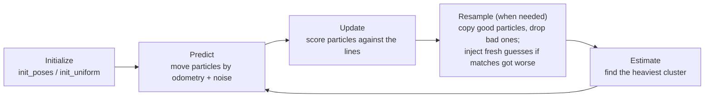

# 7. The particle filter

**Series:** [index](../README.md) · [1 Welcome](01_welcome.md) · [2 Setup](02_setup.md) · [3 Geometry](03_math_geometry.md) ·
[4 Uncertainty](04_math_probability.md) · [5 Field](05_field_model.md) · [6 Camera](06_camera.md) ·
**7 Particle filter** · [8 Which half](08_side_belief.md) · [9 Game and team](09_game_and_team.md) ·
[10 Testing](10_testing_and_evaluation.md) · [11 Progress](11_progress.md) · [12 Contributing](12_contributing.md)

This is the heart of the project:
[`td_localization/td_localization/pf.py`](../../../td_localization/td_localization/pf.py), the class
[`ParticleFilter`](../../../td_localization/td_localization/pf.py). It takes odometry ([chapter 3](03_math_geometry.md))
and floor points from the camera ([chapter 6](06_camera.md)), compares them with the map
([chapter 5](05_field_model.md)), and produces the pose estimate. The algorithm is called **Monte Carlo
Localization** (MCL).

The chapter goes slowly:

- the idea, without math;
- the four steps of each cycle: predict, update, resample, estimate;
- the parts that make it robust: recovery from being moved, the drift test and lost mode;
- how it avoids ever choosing the wrong half by itself;
- the settings, and an exercise where you kidnap a robot and watch it recover.

Keep `pf.py` open next to this chapter.

---

## 7.1 The idea, without math

Imagine 500 people standing around a soccer field. Each holds a card with a guess of the robot's pose. Every
fraction of a second:

1. **The robot says "I walked 1 cm forward."** Everyone moves their guess 1 cm forward, from *their own* guessed
   position and heading, plus a small random wobble, because walking isn't exact.
2. **The robot says "I see line points here, here and here, relative to me."** Each person lays those points onto
   the map *from their guess*. If they land on lines, that guess gets a high score; if they land on grass, a low
   score.
3. **The low scorers swap their cards for copies of high scorers' cards.** Good guesses multiply; bad ones die out.
4. **Someone reads off where most of the cards agree.** That's the estimate.

After a few rounds, the guesses crowd around the true pose. If the robot is ambiguous (two places look alike), two
crowds can form, and the filter keeps both until the robot sees something that decides it. That ability to hold
several hypotheses is the reason to use particles instead of a single best guess.

In the language of [chapter 4](04_math_probability.md): each card is a hypothesis, step 2 multiplies in the
likelihood (Bayes' rule), and the crowd is a picture of the probability distribution of the pose.

## 7.2 The cycle



In the simulations and on the bench the loop runs 30 times a second. **Predict** happens every tick; **update**
happens when a camera frame arrives (every second tick, so 15 times a second).

The state is two arrays:

- `self.p`, shape (N, 3): one row `(x, y, θ)` per particle, in the field frame;
- `self.w`, shape (N,): one **weight** per particle, all positive and summing to 1.

N is 500 normally, and 3,000 while searching from scratch ("lost mode", section 7.9).

## 7.3 Initialization

There are two ways to start.

**`init_poses(poses)`: we know roughly where the robot is.** At the start of a game, handlers put robots on known
spots; after a penalty, the robot goes back on one of two known touchline spots. The filter puts an even share of
particles around each candidate, scattered with σ = 15 cm and 0.1 rad:

```python
self.p = poses[idx] + self.rng.normal(0.0, 1.0, (n, 3)) * [sigma_xy, sigma_xy, sigma_theta]
```

`rng.normal(0, 1, (n, 3))` makes n × 3 standard normal numbers; multiplying by `[0.15, 0.15, 0.1]` scales each
column to the right σ. Vision then picks which candidate is real.

**`init_uniform()`: we don't know.** Particles are scattered uniformly over the whole field (plus 0.5 m), with
random headings, and then folded into our own half (section 7.10), because the rules guarantee the robot starts
there. This is **global localization**, and it switches on lost mode (section 7.9).

## 7.4 Predict: moving the particles

`predict(odom, odom_cov)` receives odometry `(dx, dy, dθ)` in the robot frame, plus its 3×3 covariance (how
uncertain the odometry says it is).

For each particle:

1. **Draw its own noisy version of the motion.** σ comes from the covariance's diagonal, inflated 1.5× to be
   conservative (odometry is usually overconfident), and combined in quadrature with a small floor (3 mm, 0.003 rad)
   so the cloud never stops spreading entirely. Simplified from `predict()`:

   ```python
   sigma = np.sqrt(np.diag(odom_cov)) * 1.5          # odom_noise_scale
   sigma = np.hypot(sigma, (0.003, 0.003, 0.003))   # odom_sigma_floor
   d = odom + rng.normal(0, 1, (N, 3)) * sigma       # N different noisy motions
   ```

2. **Apply it from the particle's own heading**: this is `compose` from chapter 3, written for all particles at
   once:

   ```python
   c, s = cos(p[:, 2]), sin(p[:, 2])
   p[:, 0] += c * d[:, 0] - s * d[:, 1]
   p[:, 1] += s * d[:, 0] + c * d[:, 1]
   p[:, 2] = wrap(p[:, 2] + d[:, 2])
   ```

Why add noise on purpose? The real motion differs from the reported motion by some unknown error. Spreading the
particles by that error's size makes sure some particles land near the true pose. Without it, the cloud would
shrink to a point and could never correct itself.

A **fall** is reported as "no motion, but a huge covariance" (σ ≈ 0.3 m). The predict step then spreads the cloud
widely, and the next camera frames pull it back together around the truth.

## 7.5 Update: scoring the particles

`update(obs)` is where the camera's points are compared with the map. Step by step:

**1. Take up to 120 points.** If the frame has more, a random 120 are used (`max_points`). Cost grows with
particles × points, and 120 points carry plenty of information.

**2. Skip frames with almost nothing.** Fewer than 10 points and no landmarks (for example, the head turned toward
the crowd) means the frame is ignored. A handful of points, possibly false detections, would only add noise.

**3. Give each point a σ.** From its covariance ([chapter 6](06_camera.md)), take the largest eigenvalue (the
worst direction, [chapter 4](04_math_probability.md)) and add 5 cm in quadrature (`point_sigma_floor`, for line
width and small map errors):

```math
\sigma_j = \sqrt{\lambda_{\max}(\Sigma_j) + 0.05^2}
```

A point 3 m away gets σ ≈ 7 cm; a point 6 m away gets σ ≈ 18 cm.

**4. Put every point on the map from every particle.** This is `robot_to_world` from chapter 3, for N particles × M
points at once, using numpy broadcasting ([chapter 2](02_setup.md), section 2.7):

```python
c, s = np.cos(self.p[:, 2])[:, None], np.sin(self.p[:, 2])[:, None]   # shape (N, 1)
wx = self.p[:, 0:1] + c * pts[:, 0] - s * pts[:, 1]                    # (N, 1) with (M,) → (N, M)
wy = self.p[:, 1:2] + s * pts[:, 0] + c * pts[:, 1]
```

`wx[i, j]` is where particle `i` thinks point `j` is on the field.

**5. Look up each point's distance to the nearest line** in the likelihood field ([chapter 5](05_field_model.md)):
`d[i, j]`.

**6. Score each particle.** With the robust Cauchy kernel from chapter 4, summed over points, and multiplied by a
**temperature** of 0.15:

```math
\log L_i = -0.15 \sum_j \log\!\left(1 + \left(\frac{d_{ij}}{\sigma_j}\right)^2\right)
```

```python
r2 = (d / sig_pts) ** 2
loglik -= cfg.line_temperature * np.log1p(r2).sum(axis=1)   # log1p(x) = log(1 + x), accurate for small x
```

**7. Landmarks**, if any, are scored the same way: the distance from where the particle puts the landmark to the
nearest map landmark of the same kind (an L-crossing must match an L-crossing).

**8. Update the weights** with Bayes' rule, in log form:

```python
logw = np.log(w) + loglik      # posterior ∝ prior × likelihood, as logs
logw -= logw.max()             # largest becomes 0, so exp() can't underflow to all zeros
w = np.exp(logw)
w /= w.sum()                   # normalize
```

### Why the temperature?

Points along one line are **not independent**. If the robot's guess is 3 cm off, every point along that line is 3 cm
off together. Bayes' rule assumes independent evidence, so it would count that one piece of information 100 times
and become far too sure of itself after a single frame. Multiplying the sum by 0.15 ("tempering") is a standard,
simple correction.

A toy example with three particles and three points (σ = 7 cm). Particle A's points are 0–2 cm from lines, B's
5–30 cm, C's 40–80 cm. Starting from equal weights:

| Particle | Distances (m) | Weight without tempering | Weight with temperature 0.15 |
|---|---|---|---|
| A | 0.01, 0.02, 0.00 | 0.988 | 0.599 |
| B | 0.10, 0.30, 0.05 | 0.012 | 0.310 |
| C | 0.60, 0.80, 0.40 | 0.000 | 0.090 |

Without tempering, one frame kills B and C. With it, A leads, but B survives long enough for more frames to
confirm. Over many frames the right particle still wins, but the filter doesn't bet everything on one image.

## 7.6 Resample: keeping the good guesses

After a few updates, most weight sits on a few particles and the rest are nearly useless. **Resampling** replaces
the set with a new one: particles are copied in proportion to their weight, and all weights reset to equal.

**When?** The filter measures how many particles are effectively in use, the **effective sample size**:

```math
\text{ESS} = \frac{1}{\sum_i w_i^2}
```

| Weights | ESS |
|---|---|
| 4 particles, all 0.25 | 4.0 (all useful) |
| 0.7, 0.1, 0.1, 0.1 | 1.9 |
| 0.97, 0.01, 0.01, 0.01 | 1.06 (only one matters) |

It resamples when ESS drops below half the particle count (`resample_ess_fraction = 0.5`). Resampling every frame
would throw away diversity for no reason.

**How: low-variance resampling** (`_resample`). Picture the weights laid end to end along a ruler from 0 to 1, each
particle taking a stretch as long as its weight. Draw **one** random number `u` between 0 and 1, then put N equally
spaced marks at `(u + k) / N` for k = 0 … N−1. Each mark lands in some particle's stretch, and that particle gets
copied once for each mark.

Example with 4 particles, weights `[0.5, 0.3, 0.15, 0.05]` and `u = 0.1`:

- the stretches end at the cumulative sums `[0.5, 0.8, 0.95, 1.0]`;
- the marks are at `0.025, 0.275, 0.525, 0.775`;
- the marks land in particles `0, 0, 1, 1`.

So the heavy particles are copied twice each, and the light ones disappear. Using one random number instead of N
keeps the copy counts very close to the weights (always within one), which preserves diversity better than drawing
each copy independently.

```python
positions = (rng.random() + np.arange(n)) / n
idx = np.searchsorted(np.cumsum(w), positions)   # which stretch each mark falls in
p = p[idx]
```

## 7.7 Recovery: noticing you're wrong

Everything so far assumes the cloud stays near the truth. But robots get pushed, fall and get carried
([chapter 1](01_welcome.md)). Then **every** particle can be wrong, and reweighting alone can't fix that: you can
only choose among guesses you have. The filter needs to notice and add new guesses. This design is known as
**augmented MCL with sensor resetting**.

### Match quality

During `update`, the filter computes a **match quality** between 0 and 1: for each point, `1 / (1 + r²)` (1 when on a
line, near 0 when far off), averaged over points and weighted over particles. Then it keeps two moving averages of
it ([chapter 4](04_math_probability.md), section 4.8):

- **slow** (α = 0.005): about 13 seconds of memory at 15 frames per second. "How good are matches normally, here?"
- **fast** (α = 0.3): a fraction of a second. "How good are they right now?"

Comparing the two cancels out the scene: some views just have fewer, blurrier lines. What matters is a **sudden
drop**:

```math
\text{drop} = 1 - \frac{q_{\text{fast}}}{q_{\text{slow}}}, \qquad
\text{recovery} = \text{clip}\!\left(\frac{\text{drop} - 0.3}{1 - 0.3},\; 0,\; 1\right)
```

A drop below 30% counts as normal variation (recovery 0). Above that, recovery rises toward 1, and the filter acts in
proportion:

| q_slow | q_fast | Drop | Recovery | Particles replaced | Extra spread ("roughening") |
|---|---|---|---|---|---|
| 0.8 | 0.8 | 0% | 0 | 0% | 0 |
| 0.8 | 0.6 | 25% | 0 | 0% | 0 |
| 0.8 | 0.4 | 50% | 0.29 | 2.9% | 4.3 cm |
| 0.8 | 0.2 | 75% | 0.64 | 6.4% | 9.6 cm |

Two actions, both proportional to `recovery`:

- **Roughening:** every particle gets an extra random shift (up to 15 cm and 0.08 rad at full recovery), so a cloud
  that's slightly off can slide to the right place.
- **Injection:** up to 10% of particles are replaced with fresh guesses from anywhere on the field.

The flag `pf.degraded` is True while the drop exceeds 30%. Other modules read it as "don't trust the pose right
now".

### Sensor resetting: smart fresh guesses

A random pose almost never lands near the truth: the chance of being within 0.3 m and ±6° is about 1 in 16,000 on
the M-Field. Injecting purely random particles would take minutes to find the robot.

So `_propose` generates **40 times** as many random poses as it needs, scores each one against 40 points of the
**current** frame (cheaply, with the same Cauchy kernel), and keeps only the best. The current observation "resets"
where to look. Recovery takes seconds instead of minutes.

## 7.8 The drift test: noticing you're a little wrong

The quality drop catches big failures. It misses a quieter one: after a push, the whole cloud can sit 0.5–1.5 m off
with mediocre, but not dramatically worse, matches. It then crawls back slowly, if at all.

`_drift_test` asks a local question on every informative frame: **is there a clearly better pose near the current
estimate?**

1. Make 200 candidate poses around the estimate: half close by (σ 0.6 m, 0.25 rad), half wider (σ 1.5 m, 0.6 rad).
2. Score the estimate and every candidate on the same 40 points, without tempering.
3. Compute the best candidate's advantage **per point**. If it beats the estimate by more than 0.5 per point, this
   frame "votes" that the estimate has drifted.
4. If at least **3 of the last 4** informative frames voted, the test **fires**: the best 5% of candidates are
   injected. It keeps firing every frame while the gap persists.

Comparing against neighbors on the same frame makes the test **self-calibrating**: the scene's content and noise
level affect the estimate and the candidates equally. In normal tracking the estimate is already the local best, so
nothing happens. The 3-of-4 vote means one noisy frame never triggers it. And because candidates stay near the
estimate, the test can never move the robot to the other half. `pf.drift` reports whether it fired on the last
update.

## 7.9 Lost mode: finding yourself from scratch

After `init_uniform()`, the filter is **lost** (`pf.lost` is True):

- it uses 3,000 particles instead of 500;
- on every informative frame it replaces 10% of them with screened proposals (10 candidates screened per particle,
  cheaper but many more);
- no roughening: the proposals do the searching.

It leaves lost mode when the best cluster (section 7.11) has held at least 80% of the weight for 15 informative
updates in a row (about 1 s). Then the next resample shrinks back to 500 particles, and the half it found becomes the
side reference (next section).

In the reference test, starting from the sideline with no known position, it converges in about 1 second
([chapter 11](11_progress.md)).

## 7.10 Symmetry: the filter never chooses the half

From [chapter 5](05_field_model.md): a pose and its mirror score **identically** against the lines. So if the
filter injected a random particle at the mirror of the truth, that particle would score just as well as a correct
one, and the cloud could split or jump to the wrong half. That would be an own goal waiting to happen.

The rule in `pf.py` is: **the particle filter never decides the half.** Every time it creates new poses (random
starts, injected particles, proposals), it **folds** each one onto the believed half (`_fold_to_reference`):

- while lost in our own half: any pose with x > 0 is replaced by its mirror;
- otherwise: any pose whose mirror is closer to `side_reference` is replaced by its mirror, using the pose distance
  with heading from [chapter 3](03_math_geometry.md) (2 m per radian).

`side_reference` is a pose on the believed half. It's set:

- from the known candidates in `init_poses` (they're on the right half by the rules);
- from the found cluster when lost mode ends;
- by the **side belief** ([chapter 8](08_side_belief.md)), when it mirrors the filter.

It **follows** the estimate only while the filter is healthy: not lost, not degraded, a confident best cluster
(≥ 80% weight), and moving continuously (less than 1.5 m per update, unless it has been confident for 30 estimates in
a row). This matters: after a kidnap, a wrong cloud slides around; if the reference followed it, it would drag the
folding of new particles along, and recovery would converge to the wrong half.

So the half is decided in exactly one place, by evidence the filter can't see. That's the next chapter.

## 7.11 Estimate: reading off the answer

The particles are a cloud, possibly several clouds. `estimate()` turns them into one answer by **clustering**:

1. **Seed:** split the field into cells 0.5 m × 0.5 m × 0.5 rad, add up the weight in each cell, and take the
   heaviest cell's weighted mean (`_densest_seed`). Using a cell's total weight, not the single heaviest particle,
   stops one lucky injected particle from becoming the estimate.
2. **Grow:** the cluster is every unassigned particle within 0.5 m and 0.5 rad of the seed.
3. **Repeat** for the remaining particles, up to 8 clusters, ignoring clusters with less than 5% of the weight.
4. Each cluster reports its **weighted mean pose**, its covariance, its total weight and its size.

**Averaging angles needs care.** The average of 179° and −179° should be 180°, but the plain arithmetic average is
0°, which is exactly backwards. The code averages the **directions** instead: take the weighted mean of `cos θ`
and of `sin θ`, then `atan2` of the two. That's a **circular mean**.

**Hysteresis.** If the best cluster holds less than 80% of the weight and there's another cluster with at least 20%
near the previous estimate, the filter keeps reporting that one. Two similar-weight clusters would otherwise make the
estimate flicker back and forth.

The result is an [`Estimate`](../../../td_localization/td_localization/pf.py): `pose`, `cov`, `weight` (the best
cluster's share of the weight) and the list of `clusters`.

**Careful: weight measures agreement, not correctness.** In the exercise below, right after the kidnap, the weight
stays at 1.00 while the error is 3 m: all particles agree on the wrong place. That's why the filter also reports
`degraded` and `drift`, and why the side belief exists.

The simulations turn these flags into a status (`status_of` in
[`suite.py`](../../../td_localization/td_localization/suite.py)):

- `initializing` while lost;
- `uncertain` while degraded, drifting, or with a best cluster under 80%;
- `localized` otherwise.

## 7.12 The settings

All settings are in [`PFConfig`](../../../td_localization/td_localization/pf.py). The ones you're most likely to
touch:

| Setting | Default | Effect |
|---|---|---|
| `n_particles` | 500 | More = more robust, slower. |
| `max_points` | 120 | Line points used per update. |
| `point_sigma_floor` | 0.05 m | Minimum point uncertainty. |
| `line_temperature` | 0.15 | How strongly one frame reshapes the weights. |
| `odom_noise_scale` | 1.5 | How much to distrust odometry. |
| `resample_ess_fraction` | 0.5 | Resample below this ESS fraction. |
| `inject_max_fraction` | 0.1 | Most particles replaced per update at full recovery. |
| `drop_threshold` | 0.3 | Quality drop counted as normal variation. |
| `drift_margin_per_point`, `drift_votes` / `drift_window` | 0.5, 3 / 4 | Drift test sensitivity. |
| `n_particles_lost` | 3000 | Particles during global search. |

Each has a comment in the code explaining what it does and, often, how its value was chosen. Change them only with
the evaluation suite as the judge ([chapter 10](10_testing_and_evaluation.md)): a change that helps one scenario
often hurts another.

**Speed:** with 500 particles × 120 points, an update is 60,000 distance lookups. On a laptop, the reference
tracking run takes about 1 ms per cycle typically (median), and about 15 ms in the slowest 5% of cycles.

## 7.13 Try it: kidnap a robot

This runs the filter by hand on a simulated walk. After 10 s, the robot is pushed 1.5 m and turned 0.6 rad without
telling the filter:

```python
import math

from td_field_model import FieldModel
from td_field_model.scenarios import ScenarioBuilder, compose
from td_field_model.sim import NoiseModel, Simulator
from td_localization.pf import ParticleFilter

fm = FieldModel.builtin("hsl_m_2026")
sb = ScenarioBuilder(fm, seed=1).start((-3.0, 1.0, 0.3)).walk(10.0)
sb.kidnap(compose(sb.pose, (1.5, 0.0, 0.6)))   # pushed 1.5 m and turned, without telling the filter
steps = sb.walk(10.0).steps
sim = Simulator(fm, noise=NoiseModel(false_positives=2.0), seed=1)
pf = ParticleFilter(fm, seed=1)
pf.init_poses([steps[0].true_pose])            # the starting spot is known

for i, s in enumerate(steps):
    if i:
        pf.predict(s.odom, s.odom_cov)         # move every guess by the odometry
    if i % 2 == 0:                             # a camera frame every 2nd tick (15 Hz)
        pf.update(sim.render(s.true_pose, s.head_yaw, s.head_pitch, t=s.t))
    e = pf.estimate()
    if i % 30 == 0 or s.event == "kidnap":
        err = math.hypot(e.pose[0] - s.true_pose[0], e.pose[1] - s.true_pose[1])
        print(f"t={s.t:5.2f}s error={err:4.2f} m weight={e.weight:.2f} ESS={pf.ess:5.1f} {s.event or ''}")
```

It takes a few seconds. You should see something like:

```text
t= 0.00s error=0.03 m weight=1.00 ESS=500.0 initial
...
t=10.00s error=0.01 m weight=1.00 ESS=342.2
t=10.03s error=1.51 m weight=1.00 ESS=342.2 kidnap
t=11.00s error=2.75 m weight=1.00 ESS=292.5
t=12.00s error=3.14 m weight=1.00 ESS=457.4
t=13.00s error=0.47 m weight=1.00 ESS=306.1
t=14.00s error=0.07 m weight=1.00 ESS=416.5
...
t=20.00s error=0.00 m weight=1.00 ESS=500.0
```

Tracking holds the error to a few centimeters. The kidnap jumps it to 1.5 m, and it briefly gets worse, because
odometry keeps moving the wrong cloud. Then, about 3 s later, the filter is back within centimeters. Counting over
the run, matches were "degraded" for about 1 s and the drift test fired on 5 frames, together injecting about 250
fresh particles.

Experiments:

1. Remove the kidnap: the error should stay under ~5 cm throughout.
2. Make the push bigger: `(3.0, 1.0, 1.5)`. Does it still recover? How long does it take?
3. Use fewer particles: `pf = ParticleFilter(fm, config=PFConfig(n_particles=100), seed=1)` (import `PFConfig`
   from the same module). What changes?
4. Replace `init_poses(...)` with `pf.init_uniform()` and print `pf.lost` too. How long until it finds itself?

## 7.14 Summary

- MCL keeps **N weighted guesses**. Each cycle: **predict** with noisy odometry, **update** with the robust,
  tempered line likelihood, **resample** when ESS falls, **estimate** the heaviest cluster.
- **Tempering** (×0.15) compensates for correlated points; the **Cauchy kernel** shrugs off false detections.
- **Recovery:** a fast/slow match-quality drop triggers roughening and **screened injection**; the **drift test**
  catches small offsets; **lost mode** handles starting from nothing.
- **The filter never chooses the half.** All new poses are folded toward `side_reference`, which only follows a
  healthy estimate.
- Weight is agreement, not truth: watch `degraded`, `drift` and `lost` too.

---

**Next:** [8. Which half am I on?](08_side_belief.md)
