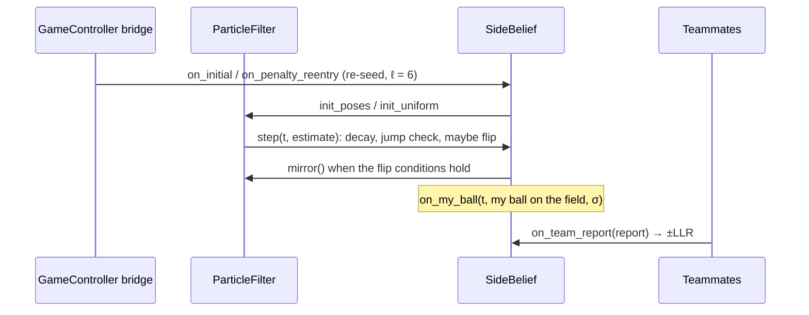

# 8. Which half am I on?

**Series:** [index](../README.md) · [1 Welcome](01_welcome.md) · [2 Setup](02_setup.md) · [3 Geometry](03_math_geometry.md) ·
[4 Uncertainty](04_math_probability.md) · [5 Field](05_field_model.md) · [6 Camera](06_camera.md) ·
[7 Particle filter](07_particle_filter.md) · **8 Which half** · [9 Game and team](09_game_and_team.md) ·
[10 Testing](10_testing_and_evaluation.md) · [11 Progress](11_progress.md) · [12 Contributing](12_contributing.md)

The particle filter finds where the robot is **up to a 180° flip** and keeps whichever half it started on, through
continuity ([chapter 7](07_particle_filter.md), section 7.10). This chapter covers the module that judges whether
that half is right, and fixes it when it isn't:
[`SideBelief`](../../../td_localization/td_localization/side.py) in
[`td_localization/td_localization/side.py`](../../../td_localization/td_localization/side.py).

You'll learn:

- what the side belief outputs and who uses it;
- the three kinds of evidence: game events, teammates' ball sightings and opponents' positions;
- the math of comparing ball positions, step by step;
- how confidence is lost when something suspicious happens;
- when and how the filter gets flipped, including the team's consensus rule;
- what can't be fixed, and why.

---

## 8.1 What it outputs

One number: **`confidence`**, the probability that the particle filter is on the correct half.

- Near 1: trust the half. Shoot at the goal the map says is the opponent's.
- Near 0.5: no idea.
- Below 0.9: **don't shoot** (`avoid_shooting` is True). A missed chance costs little; an own goal costs a lot.

Internally it keeps the **log-odds** ℓ ([chapter 4](04_math_probability.md), section 4.7), because evidence then
simply adds:

```math
\text{confidence} = \frac{1}{1 + e^{-\ell}}
```

ℓ is clipped to ±8 (confidence between 0.0003 and 0.9997), so the robot can always be talked out of a belief.

## 8.2 Evidence 1: game events (the strongest)

The rules say where robots are at certain moments, so these moments reset everything.

| Event | What the rules say | What the side belief does |
|---|---|---|
| **Initial** (start of each half, after a timeout) | Handlers place every robot in its own half. | `on_initial`: re-seed the filter with the known starting spots (`init_poses`), or search our own half if they're unknown (`init_uniform`). Set ℓ = 6 (confidence 0.9975). |
| **Penalty re-entry** | The robot is placed on its own half's touchline, level with the penalty mark, facing the field. Which touchline isn't announced. | `on_penalty_reentry`: re-seed with **both** touchline candidates; vision picks the right one. Set ℓ = 6. |

These calls come from the GameController bridge ([chapter 9](09_game_and_team.md)). After a re-seed there's a
2-second **grace period**: with two candidates, the estimate may jump from one to the other while vision decides,
and that jump is expected, not suspicious (section 8.5).

## 8.3 Evidence 2: teammates' ball sightings

This is the clever part. Suppose I see the ball and work out where it is on the field, using my pose: my sighting
is relative to me, so I convert it with `robot_to_world` ([chapter 3](03_math_geometry.md)). My teammate does the
same with their pose.

- If we're both on the correct half, we get **the same** field position (up to noise).
- If **I** am mirrored (my pose is `(−x, −y, θ + π)` of the truth), the ball position I compute is mirrored too:
  `(−bx, −by)`. My teammate's ball and mine are then on **opposite** sides of the center mark.

So comparing my ball with my teammate's tests my half. The image explains why this only works when the ball is
away from the center: near the center mark, `(bx, by)` and `(−bx, −by)` are almost the same point, so the
comparison can't tell the two cases apart.

```text
   my ball if I'm right          teammate's ball
          (2.0, 1.0)  ≈≈≈≈≈≈≈≈≈  (2.1, 0.9)        → I'm probably right

   my ball if I'm mirrored
         (−2.0, −1.0) ←── far from (2.1, 0.9)       → the mirrored hypothesis doesn't fit
```

### The math

Let `m` be my ball position and `b` my teammate's. Compute two squared distances:

```math
d_{\text{direct}}^2 = |m - b|^2, \qquad d_{\text{mirror}}^2 = |m + b|^2
```

(`m + b` is the same as `m − (−b)`: the distance from my ball to the mirror of theirs.)

Treat the difference between the two balls as normally distributed noise with variance

```math
v = \sigma_{\text{mine}}^2 + \sigma_{\text{theirs}}^2 + 2 \times 0.3^2
```

That's my ball's uncertainty, theirs, and 0.3 m of pose uncertainty for each of us, all added in quadrature. The
evidence is then the **log-likelihood ratio** of the two hypotheses "my half is right" and "I'm mirrored", using the
Gaussian from chapter 4. The normalizing constants cancel and what's left is:

```math
\text{LLR} = \log\frac{\exp(-d_{\text{direct}}^2 / 2v)}{\exp(-d_{\text{mirror}}^2 / 2v)} = \frac{d_{\text{mirror}}^2 - d_{\text{direct}}^2}{2v}
```

Positive LLR supports my half, negative contradicts it. Then three safeguards:

1. **Clip** to ±2 per report, so one report can never be decisive on its own.
2. **Gate:** if **neither** hypothesis fits (both distances more than 3σ, about 1.5 m here), the two robots disagree
   for some other reason: one of them is just badly localized, or they're looking at different balls. That's no
   evidence about halves, so the LLR is 0.
3. **Weight by the teammate's own confidence:** `(c − 0.6) / 0.4`. A teammate at 0.98 counts 0.95×; below 0.6 is
   ignored entirely. **The goalkeeper counts double**, because it rarely leaves its own goal area and is almost never
   confused about its half.

**Worked examples** (both balls with σ = 0.2 m, so v = 0.04 + 0.04 + 0.18 = 0.26):

| My ball | Teammate's ball | d²_direct | d²_mirror | Raw LLR | After clip × weight (0.95) |
|---|---|---|---|---|---|
| (2, 1) | (2.1, 0.9) | 0.02 | 20.4 | +39.2 | **+1.90** (goalkeeper: +3.80) |
| (2, 1) | (−2, −1.1) | 20.4 | 0.01 | −39.2 | **−1.90** |
| (0.1, 0) | (0.1, 0.05) | 0.0025 | 0.0425 | +0.077 | +0.07 (ball at the center: almost no information) |
| (2, 1) | (5, −3) | 25 | 53 | | **0** (gated: neither fits) |

### Timing

Teammates report about twice a second, the network adds delay, and each robot only sees the ball part of the time.
So exact coincidences are rare. The side belief keeps the **last 4 seconds** of my own sightings and matches each
report against my sighting **nearest in time**, up to 3 seconds apart. The ball may have rolled in between, so my
uncertainty is widened by 1 m/s × the time gap: a 1-second gap turns σ = 0.2 m into about 1.02 m. Old comparisons
are still useful far from the center (where the two hypotheses are meters apart) and fade naturally near it.

A report that arrives before I've seen the ball waits in a queue and is matched when I next do.

**My own sightings only count while my pose is trustworthy**: the filter isn't lost or degraded, and its best
cluster holds at least 80% of the weight. Otherwise "my ball on the field" is meaningless.

## 8.4 Evidence 3: opponents at Set (weak)

During the Set state, before kick-off, opponents must stand in their own half, which is x > 0 in our frame.
`on_opponents_at_set` adds +0.5 per opponent seen at x > 0.5 m and −0.5 per opponent at x < −0.5 m. It's a weak cue,
because robot detection is unreliable. Nothing calls it yet: it needs an opponent detector.

## 8.5 Losing confidence

Confidence must also go **down** when something suspicious happens, because then continuity no longer vouches for
the half.

- **While the filter is lost or degraded,** ℓ decays toward 0 with a 6-second time constant: ℓ ← ℓ · e^(−Δt/6).
  After 6 s it's at 37% of its value.
- **When the estimate jumps** (moves more than 1.5 m, or turns more than 90°, between cycles), the robot has
  probably been moved or the filter has relocalized. ℓ is capped at 1 (confidence 0.73): below the 0.9 shooting
  threshold, so the robot stops shooting until fresh evidence arrives. Falls turn the robot by up to about 60°,
  so 90° is safely above that. Jumps don't count during the grace periods after a re-seed or after lost mode
  ends, when hopping between hypotheses is expected.

## 8.6 Flipping

When the evidence says "you're mirrored", the side belief **mirrors the whole particle filter** (`pf.mirror()`:
every particle `(x, y, θ) → (−x, −y, θ + π)`). It does this only when **all** of these hold:

1. ℓ is below −4 (confidence under 1.8%);
2. it has stayed there for **1 second** (`flip_hold`);
3. no flip happened in the last **3 seconds** (`flip_refractory`);
4. **consensus:** in the last 15 seconds, the evidence against came from **the goalkeeper**, or from **at least 2
   different teammates**.

After a flip, ℓ becomes min(−ℓ, 3), so confidence is 0.95: the new half still has to prove itself. My stored ball
sightings are mirrored too, since they were computed with the old pose.

### Why the consensus rule

In simulation, a teammate that had **itself** just been kidnapped became confidently wrong, and its reports flipped a
perfectly healthy robot. One source must never be enough. So the team decided (2026-10-27, logged in the
[implementation plan](../../implementation_plan.md) §9) that a flip needs the goalkeeper or ≥ 2 teammates.

The accepted cost: with no goalkeeper and only one teammate, teammates can't flip a robot. It stays unsure, and
doesn't shoot, until a game event re-seeds it. **This is a team decision: don't change `min_flip_sources` without
asking.**

## 8.7 What can't be fixed

Consider the worst case: a robot is carried across the field to (nearly) the **exact mirror** of where it was, and
it has no teammates. Its new true pose's mirror is almost its old pose, so the filter's estimate doesn't jump at
all. Every line still fits, and nothing looks wrong. It is **confidently wrong**, and only outside evidence can fix it.

The test suite includes this case on purpose (`kidnap_cross_alone`). It fails, and its report says so: 20 seconds on
the wrong half with confidence 0.99 ([chapter 11](11_progress.md)). The same kidnap **with** teammates
(`kidnap_cross_team`) is caught: the filter flips and is right again within 2.7 s. That's the design working as
intended: the field gives no evidence, so the robot relies on its team and on the referee's events.

## 8.8 How it fits together, per cycle



`step(t, estimate)` must be called **once per cycle**, after `pf.estimate()`. That's where decay, jump detection and
flipping happen.

## 8.9 The settings

All in [`SideConfig`](../../../td_localization/td_localization/side.py):

| Setting | Default | Meaning |
|---|---|---|
| `known_placement_logodds` | 6.0 | ℓ after Initial / re-entry (0.9975) |
| `flip_threshold`, `flip_hold` | −4.0, 1.0 s | Flip below this ℓ, held this long |
| `flip_refractory` | 3.0 s | No second flip within this time |
| `min_flip_sources`, `flip_sources_window` | 2, 15 s | **Team decision:** consensus needed to flip |
| `report_llr_clip` | 2.0 | Max evidence per report |
| `pose_sigma` | 0.3 m | Pose uncertainty per robot in the ball comparison |
| `match_gate_sigma` | 3.0 | Ignore reports where neither hypothesis fits within 3σ |
| `goalkeeper_weight` | 2.0 | Goalkeeper's evidence counts double |
| `min_teammate_confidence` | 0.6 | Ignore less sure teammates |
| `ball_max_age`, `ball_speed`, `ball_history_s` | 3 s, 1 m/s, 4 s | Matching sightings in time |
| `degraded_tau` | 6 s | Decay while lost or degraded |
| `jump_distance`, `jump_heading` | 1.5 m, 90° | What counts as a jump |
| `after_jump_logodds` | 1.0 | Cap after a jump (0.73) |
| `avoid_shooting_below` | 0.9 | Behavior's no-shot threshold |

The tests are [`test_side.py`](../../../td_localization/test/test_side.py) (each rule in isolation) and
[`test_team_sim.py`](../../../td_localization/test/test_team_sim.py) (three simulated robots talking over a lossy
network).

## 8.10 Try it

```python
from td_field_model import FieldModel
from td_localization.pf import ParticleFilter
from td_localization.side import SideBelief, TeamReport

fm = FieldModel.builtin("hsl_m_2026")
pf = ParticleFilter(fm, seed=0)
side = SideBelief(pf)

side.on_initial(0.0, [(-3.0, 1.0, 0.3)])          # placed on a known spot in our half
print(f"after Initial: confidence {side.confidence:.4f}")          # 0.9975

side.step(0.1, pf.estimate())   # each cycle: lets the side belief check that my pose is trustworthy
side.logodds = 0.0              # pretend something made us unsure (P = 0.5)

# I see the ball at (2, 1) on the field; teammate 3 reports it at (2.1, 0.9)
side.on_my_ball(0.2, (2.0, 1.0), 0.2)
llr = side.on_team_report(TeamReport(0.2, 3, (2.1, 0.9), 0.2, side_confidence=0.98))
print(f"teammate agrees: llr {llr:+.2f}, confidence {side.confidence:.3f}")       # +1.90, 0.870

# The goalkeeper agrees too (its evidence counts double)
llr = side.on_team_report(TeamReport(0.2, 1, (2.05, 0.95), 0.2, 0.98, is_goalkeeper=True))
print(f"goalkeeper agrees: llr {llr:+.2f}, confidence {side.confidence:.4f}")    # +3.80, 0.9967

# Now two teammates keep seeing the ball where MY ball would be if I were mirrored
side.logodds = 0.0
t = 0.3
while t < 3.0 and side.flips == 0:
    side.on_my_ball(t, (2.0, 1.0), 0.2)
    side.on_team_report(TeamReport(t, 2, (-2.0, -1.0), 0.2, 0.98))
    side.on_team_report(TeamReport(t, 3, (-2.1, -0.9), 0.2, 0.98))
    flipped = side.step(t, pf.estimate())
    print(f"t={t:.1f}s logodds {side.logodds:+.2f} confidence {side.confidence:.3f}" + ("  FLIPPED" if flipped else ""))
    t = round(t + 0.2, 1)
print("filter estimate after the flip:", tuple(round(v, 2) for v in pf.estimate().pose))
```

Output:

```text
after Initial: confidence 0.9975
teammate agrees: llr +1.90, confidence 0.870
goalkeeper agrees: llr +3.80, confidence 0.9967
t=0.3s logodds -3.80 confidence 0.022
t=0.5s logodds -7.60 confidence 0.001
t=0.7s logodds -8.00 confidence 0.000
...
t=1.3s logodds -8.00 confidence 0.000
t=1.5s logodds +3.00 confidence 0.953  FLIPPED
filter estimate after the flip: (3.02, -1.02, -2.84)
```

ℓ drops below −4 at t = 0.5 s, holds for 1 s, and at t = 1.5 s the filter is mirrored from about (−3, 1) to
(3, −1). Experiments:

1. Remove teammate 3's line. Does it still flip? (It shouldn't: one source isn't consensus.)
2. Then make teammate 2 the goalkeeper (`is_goalkeeper=True`). Now?
3. Move the balls near the center: mine at (0.1, 0.0), and the teammates' at the mirrored spots (−0.1, 0.0) and
   (−0.2, 0.1). How fast does ℓ move?

<details>
<summary>Answers</summary>

1. No. ℓ reaches −8 but the consensus check fails, so confidence just stays near 0: the robot knows something is
   wrong and won't shoot, but doesn't flip on one teammate's word.
2. Yes: the goalkeeper alone is enough.
3. Slowly: after almost 3 s, ℓ has only reached about −3 and there's no flip. Near the center, the two hypotheses
   predict almost the same ball position, so each report carries little evidence.

</details>

## 8.11 Summary

- The side belief outputs **confidence** that the filter's half is right; behavior shouldn't shoot below 0.9.
- **Game events** (Initial, penalty re-entry) re-seed the filter and set high confidence.
- **Teammates' balls:** LLR = (d²_mirror − d²_direct) / 2v, clipped, gated, weighted; the goalkeeper counts double.
- Confidence **decays** while the filter is unsure, and is **capped** after a jump.
- A **flip** needs ℓ < −4 for 1 s, no recent flip, and **consensus** (the goalkeeper, or ≥ 2 teammates).
- A mirror kidnap with no teammates is undetectable by design; teammates and game events are the remedy.

---

**Next:** [9. The GameController and teammates](09_game_and_team.md)
