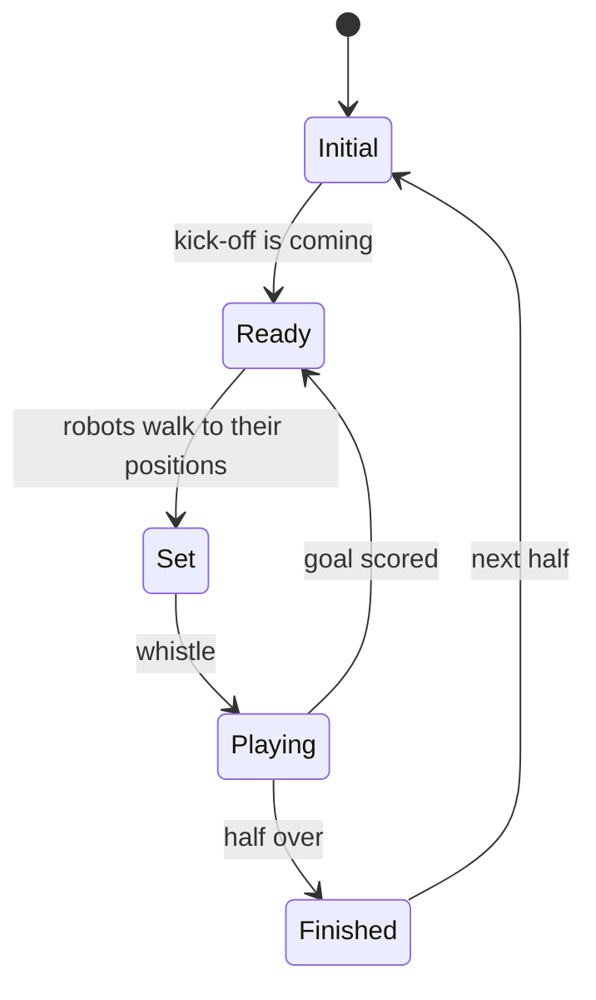

# 9. The GameController and teammates

**Series:** [index](../README.md) · [1 Welcome](01_welcome.md) · [2 Setup](02_setup.md) · [3 Geometry](03_math_geometry.md) ·
[4 Uncertainty](04_math_probability.md) · [5 Field](05_field_model.md) · [6 Camera](06_camera.md) ·
[7 Particle filter](07_particle_filter.md) · [8 Which half](08_side_belief.md) · **9 Game and team** ·
[10 Testing](10_testing_and_evaluation.md) · [11 Progress](11_progress.md) · [12 Contributing](12_contributing.md)

[Chapter 8](08_side_belief.md) relied on two outside sources: **game events** from the referee and **ball reports**
from teammates. This chapter covers the package that talks to both over the network,
[`td_game`](../../../td_game/), plus the bridge that connects it to localization.

You'll learn:

- what the GameController is and what it broadcasts;
- the networking basics needed to read the code (UDP, ports, bytes);
- how game states and penalties become localization events;
- how robots talk to each other in 22 bytes;
- the strict team message budget, and the math that spreads it over a game.

`td_game` uses only the Python standard library: no numpy, no ROS.

---

## 9.1 The GameController

The **GameController** is the official referee program for HSL, run on a laptop next to the field. A human referee
assistant clicks buttons in it, and it broadcasts the game's state to every robot over the field's Wi-Fi.

The main **game states**, in order:



- **Initial:** robots stand still and are placed by handlers, **in their own half**.
- **Ready:** robots walk to kick-off positions.
- **Set:** robots must stand still; any motion gets a "Motion in Set" penalty.
- **Playing:** the game is on.
- **Finished:** the half is over.

On top of these there's the **game phase** (normal, penalty shoot-out, extra time, timeout) and per-robot
**penalties**: pushing, leaving the field, being picked up, and so on.

## 9.2 Networking in five minutes

Skip this if you know sockets.

- **IP address:** each device on a network has one, like `192.168.1.20`. `127.0.0.1` always means "this computer",
  which tests use to talk to themselves.
- **Port:** a number from 0 to 65535 that says which program on a device a message is for. The GameController
  broadcasts on port **3838**, robots answer on **3939**, and team messages use **10000 + team number**.
- **UDP:** a simple way to send one message ("datagram") at a time. There's no connection and no delivery
  guarantee: messages can be lost, duplicated or arrive out of order. The code must cope with all three.
- **Broadcast:** sending one message to every device on the local network at once.
- **Bytes and packing:** a message is a sequence of bytes (numbers 0–255). To send a number like `−3.0` meters, the
  code converts it to an integer (−300 centimeters) and writes it as two bytes. Python's `struct` module does this:
  `struct.pack("<h", -300)` gives 2 bytes. **Little-endian** (`<`) means the least significant byte comes first,
  which is what the GameController uses.

## 9.3 The control message

Twice a second (5 times a second while the game is stopped), the GameController broadcasts a **control message**:
158 bytes starting with the letters `RGme`, version 20. The layout is in the docstring of
[`gc_data.py`](../../../td_game/td_game/gc_data.py), copied from the official C header and cross-checked against the
official Wireshark dissector:

| Offset | Contents |
|---|---|
| 0 | `RGme` header (`RGTD` = "true data" for monitors; robots must ignore it) |
| 4–13 | version, packet number, players per team, competition type, stopped, game phase, state, set play, first half, kicking team (one byte each) |
| 14, 16 | seconds remaining, secondary time (2 bytes each, signed) |
| 18 | two teams, 70 bytes each: team number, colors, goalkeeper, score, penalty shot, single shots, **message budget**, then 20 players × (penalty, seconds until unpenalized, cautions) |

`parse_control` turns the bytes into a [`ControlData`](../../../td_game/td_game/gc_data.py) object and rejects
anything malformed, a different version, or monitor data. Robots also send back a 32-byte **status message**
(`RGrt`) with their pose, whether they've fallen, and their ball sighting. It uses the same field frame as ours, own
goal at −x ([chapter 3](03_math_geometry.md)), so no conversion is needed.

## 9.4 From messages to events

[`GameStateTracker`](../../../td_game/td_game/game_state.py) in
[`game_state.py`](../../../td_game/td_game/game_state.py) receives every control message and reports only what
**changed**, as a list of [`GameEvent`](../../../td_game/td_game/game_state.py)s:

| Event | When |
|---|---|
| `state` | The game state changed (`detail` = the new state's name). |
| `initial` | The game entered Initial: start of a half or after a timeout. Robots are placed in their own half. |
| `penalized` | This robot got a penalty (`detail` = its name; `in_place` = whether it stays where it is). |
| `reentry` | A standard removal penalty ended: the robot is back on its own-half touchline. |
| `unpenalized_in_place` | A "Motion in Set" penalty ended. The robot never moved. |
| `replaced` | A penalty given during Initial or a timeout ended; the robot was put back as in Initial. |
| `half` | First/second half or the game phase changed. |
| `gc_lost` / `gc_back` | No valid message for 3 s, or messages resumed. |

Because UDP can duplicate and reorder messages, the tracker checks the **packet number** (one byte, wrapping from
255 to 0). A packet is new only if it's 1 to 127 steps ahead of the last one. Messages for a different game (another
field's GameController on the same network) are ignored, because our team number isn't in them.

**How penalties are interpreted** (from the GameController's source code; details in the LOC-08 handoff):

- **Motion in Set:** served in place, cleared automatically after 15 s → `unpenalized_in_place`.
- **A penalty given in Initial or a timeout** (picked up for service): put back as in Initial → `replaced`.
- **Sent off:** permanent; no re-entry.
- **Substitute:** *assumed* to enter like a re-entry. This is unconfirmed and should be checked against the 2027
  rules.
- **Everything else** (pushing, leaving the field, …): standard removal → `reentry`.

## 9.5 The bridge to localization

[`GameBridge`](../../../td_localization/td_localization/game_bridge.py) in
[`game_bridge.py`](../../../td_localization/td_localization/game_bridge.py) is short and worth reading in full. It
maps events to the side belief:

| Event | Action |
|---|---|
| `initial`, `replaced` | `side.on_initial(t, start_poses)`: re-seed from the team's starting spots, or search our own half. |
| `penalized` (not in place) | `paused = True`. The robot is being carried: the caller must stop feeding odometry and vision to the filter, because being carried isn't walking, and the view from the sideline is meaningless. |
| `reentry` | `paused = False`; `side.on_penalty_reentry(t, both touchline spots)`. |
| `unpenalized_in_place` | Nothing: the robot never moved. |

It also converts a teammate's message into a side-belief
[`TeamReport`](../../../td_localization/td_localization/side.py), only if the teammate saw the ball within the last
3 s and isn't fallen. The report's time is set to when the teammate *saw* the ball (`t − ball_age`), not when the
message arrived.

## 9.6 Team messages

Robots on a team may talk to each other, under strict rules (HSL 2026):

- UDP broadcast on port **10000 + team number**, through the field's access point;
- at most **512 bytes** per message;
- **12,000 messages per team per game**, plus 600 per added minute and 6,000 for extra time. Only messages sent
  in Ready, Set and Playing count;
- **exceeding the budget nullifies the team's goals.**

Our message, [`TeamMessage`](../../../td_game/td_game/team_msg.py) in
[`team_msg.py`](../../../td_game/td_game/team_msg.py), packs everything localization and behavior need into **22
bytes**:

| Bytes | Field | Encoding |
|---|---|---|
| 4 | magic `TDLc` | identifies our format (other teams share the network) |
| 1 | version | 1 |
| 1 | player number | 1–20 |
| 1 | flags | goalkeeper, fallen, localized, ball seen (one bit each) |
| 1 | side confidence | 0–255 for 0–1 |
| 2 + 2 | pose x, y | centimeters, signed |
| 2 | pose θ | 1/10,000 rad |
| 1 | pose σ | centimeters (max 2.55 m) |
| 1 | ball age | 0.1 s units |
| 2 + 2 | ball x, y | centimeters, in the field frame |
| 1 | ball σ | centimeters |
| 1 | reserved | 0 |

Packing loses a little precision (1 cm, 0.0001 rad, 1/255 of confidence), which is far below the actual
uncertainty. A message for player 2 at `(−3, 1, 0.5236)`, seeing the ball at `(2, 1)`, encodes to:

```text
54 44 4c 63 01 02 0c f7 d4 fe 64 00 74 14 0c 04 c8 00 64 00 14 00
 T  D  L  c  v  p  f  c  x=-300 y=100 θ=5236 σ age bx=200 by=100 bσ r
```

`unpack` rejects anything that isn't exactly 22 bytes with our magic and version.

## 9.7 Spreading the budget

Is 12,000 a lot? A game is two 10-minute halves, 1,200 seconds. Five robots each sending twice a second would use
2 × 1,200 × 5 = **12,000**: exactly the whole budget, with nothing left for set-piece time or mistakes. So sending
must be **paced**.

[`BudgetPacer`](../../../td_game/td_game/team_msg.py) gives each robot an equal share of what's left:

```math
\text{rate} = \min\!\left(2\,\text{Hz},\;\; \frac{0.9 \times (\text{budget} - 200)}{\text{remaining seconds} \times \text{robots}}\right)
```

- **budget** is the team's remaining messages, as reported by the GameController in every control message. It
  counts every teammate's sends, so the robots never need to coordinate: each just reads the same number.
- **200** messages are kept in reserve, never spent.
- **0.9** is a safety factor.
- **remaining seconds** is the counted time left: this half, plus the next if we're in the first, times 1.15 for
  the Ready/Set phases that don't stop the clock (`remaining_game_seconds`).

At kick-off with 5 robots: remaining = (600 + 600) × 1.15 = 1,380 s, so rate = 0.9 × 11,800 / 1,380 / 5 ≈
**1.54 messages per second** per robot. With 3 robots the formula gives 2.6, capped at 2 Hz. Outside counted states
(Initial, timeouts) messages are free, so the rate is just the 2 Hz cap.

**The token bucket.** The robot's loop runs at its own rate (say 30 Hz), which rarely divides evenly into the send
rate. The pacer keeps a **credit**: it grows by `rate × elapsed time` and is capped at one message; a send is allowed
when the credit reaches 1, and costs 1. Because of the cap, the bit of credit that overshoots 1 on the tick that
triggers a send is thrown away. So in practice it sends slightly *less* than the target: at a 30 Hz loop and
1.54 Hz, 90 messages a minute instead of 92 (the exercise below shows it). That errs on the safe side: the budget is
never overspent.

## 9.8 Team communication and the UDP links

[`TeamComm`](../../../td_game/td_game/team_comm.py) in [`team_comm.py`](../../../td_game/td_game/team_comm.py)
ties it together for one robot:

- `outgoing(t, msg, budget, counts, remaining_s, robots)` asks the pacer and returns the packed bytes if it's time
  to send;
- `incoming(t, payload)` decodes a received message, drops our own echo (broadcasts come back to the sender) and
  other teams' formats, and stores the latest message per teammate;
- `teammates(t)` lists teammates heard from in the last 3 s;
- `team_ball(t)` picks the most trustworthy shared ball sighting, for when our own camera doesn't see it.

It's **transport-agnostic**: it doesn't send anything itself. The actual sockets are in
[`udp.py`](../../../td_game/td_game/udp.py): [`GameControllerLink`](../../../td_game/td_game/udp.py) (listen on
3838, answer on 3939) and [`TeamLink`](../../../td_game/td_game/udp.py) (broadcast and listen on 10000 + team). The multi-robot simulation
([`team_sim.py`](../../../td_localization/td_localization/team_sim.py)) swaps the sockets for a simulated lossy
network instead.

## 9.9 Try it

```python
from td_game.team_msg import BudgetPacer, TeamMessage, pack, remaining_game_seconds, unpack

msg = TeamMessage(player_number=2, pose=(-3.0, 1.0, 0.5236), pose_sigma=0.12, side_confidence=0.97,
                  ball_xy=(2.0, 1.0), ball_sigma=0.2, ball_age=0.4)
data = pack(msg)
print(len(data), data.hex(" "))      # 22 54 44 4c 63 01 02 0c ...
print(unpack(data))                  # back again (side_confidence 0.9686: 1/255 resolution)

pacer = BudgetPacer()
remaining = remaining_game_seconds(600, first_half=True)
print(remaining)                                                          # 1380.0
for robots in (5, 3):
    print(robots, "robots:", round(pacer.rate_hz(12000, True, remaining, robots), 2), "Hz")  # 1.54, 2.0

# Token bucket at a 30 Hz loop: count sends over 60 s with a budget that allows 1.54 Hz
sends = sum(pacer.allow(i / 30, 12000, True, remaining, 5) for i in range(30 * 60))
print(sends, "messages in 60 s")     # 90: just under 1.54 × 60 ≈ 92 (see the token bucket above)
```

The `td_game` tests ([`td_game/test/`](../../../td_game/test/)) go much further: they build GameController messages
byte by byte, replay penalty sequences, and send real UDP packets to `127.0.0.1`.

## 9.10 Summary

- The **GameController** broadcasts the game state (Initial, Ready, Set, Playing, Finished) and penalties, 2× per
  second on UDP 3838.
- `GameStateTracker` turns messages into **events**, ignoring duplicates, stale packets and other games.
- `GameBridge` maps events to the side belief and **pauses** localization while the robot is carried.
- **Team messages** are 22 bytes, on UDP 10000 + team number.
- The **budget** (12,000 per game, overspending nullifies goals) is spread by `BudgetPacer`, with a reserve, a safety
  factor and a token bucket.

---

**Next:** [10. Testing and measuring](10_testing_and_evaluation.md)
