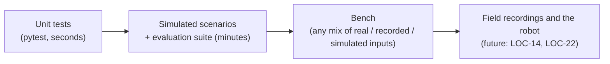

# 10. Testing and measuring

**Series:** [index](../README.md) · [1 Welcome](01_welcome.md) · [2 Setup](02_setup.md) · [3 Geometry](03_math_geometry.md) ·
[4 Uncertainty](04_math_probability.md) · [5 Field](05_field_model.md) · [6 Camera](06_camera.md) ·
[7 Particle filter](07_particle_filter.md) · [8 Which half](08_side_belief.md) · [9 Game and team](09_game_and_team.md) ·
**10 Testing** · [11 Progress](11_progress.md) · [12 Contributing](12_contributing.md)

Localization code is easy to break without noticing. A setting that makes tracking smoother can make kidnap recovery
slower; a fix for one scenario can put another on the wrong half. And there's no robot to try things on yet. So the
project leans heavily on tests and measurements, at four levels:



This chapter covers the first three, plus the test report that shows them side by side.

---

## 10.1 Unit tests

A **unit test** is a small function that runs a piece of code and checks (**asserts**) that the result is right.
**pytest** finds every function named `test_*` in files named `test_*.py` and runs them.

Each package has a `test/` folder:

| Package | Tests | What they cover |
|---|---|---|
| `td_field_model` | 78 | Dimensions against the rule book, line geometry, distance, symmetry, likelihood field, camera projection, the simulator, scenarios |
| `td_game` | 42 | Byte-exact message formats, game events, penalties, the budget pacer, UDP on `127.0.0.1` |
| `td_localization` | 86 | The particle filter's behavior and accuracy, the side belief rules, the evaluation tool, the suite, the game bridge, multi-robot runs |
| `td_bench` | 31 | Every input source, the image detector, end-to-end hardware mixes, record/replay, the CLI |

A real example, from [`test_field.py`](../../../td_field_model/test/test_field.py):

```python
def test_field_lines_are_point_symmetric(field):
    pts = field.sample_lines(spacing=0.1)
    assert np.max(field.distance(mirror_points(pts))) < 1e-9
```

It samples points along every line, mirrors them, and checks that every mirrored point lies on a line (distance
essentially 0). That one test pins down the symmetry property chapters 5 and 8 depend on. If someone ever edits the
field geometry and breaks the symmetry, this test fails.

Things to notice:

- **`field` is a fixture:** pytest passes in a prepared value (here, the built-in fields, so the test runs once per
  field size). Fixtures are defined with `@pytest.fixture` at the top of the test file.
- **Fixed seeds:** every random number generator in the tests has a seed, so a test gives the same result every
  run. A test that passes sometimes and fails sometimes ("flaky") is worse than no test.
- **Behavior over internals:** good tests check *what* the code promises, not *how* it does it. "After a kidnap the
  filter recovers within N seconds" survives a rewrite of the recovery mechanism; "`_drift_hist` has 3 entries"
  doesn't.

Run them with `python run_tests.py` ([chapter 2](02_setup.md)).

## 10.2 Simulated scenarios

To test localization end to end, you need a robot moving through a world, with ground truth. The simulator pieces
from earlier chapters combine:

1. [`ScenarioBuilder`](../../../td_field_model/td_field_model/scenarios.py) in
   [`scenarios.py`](../../../td_field_model/td_field_model/scenarios.py) generates a **trajectory**: the robot's true
   pose every 1/30 s, plus what its odometry *would* report (with noise) and where its head points.
2. [`Simulator`](../../../td_field_model/td_field_model/sim.py) ([chapter 6](06_camera.md)) renders what the camera
   would see at each true pose.
3. The filter and side belief run on the odometry and observations only, never on the truth.
4. The truth is used afterwards, to grade the estimate.

`ScenarioBuilder` is chainable, so a scenario reads like a script:

```python
steps = (ScenarioBuilder(fm, seed=1)
         .start((-3.0, 1.0, 0.3))      # an "initial" event; the filter is told this spot
         .walk(15.0)                   # wander for 15 s at 0.3 m/s, steering back inside the lines
         .fall()                       # fall and get up: turned up to ±60°, shifted 0.2 m, odometry says "no idea"
         .walk(10.0)
         .penalty_reentry("left")      # placed on the own-half touchline; both touchlines are candidates
         .walk(10.0)
         .steps)
```

Each element of `steps` is a [`Step`](../../../td_field_model/td_field_model/scenarios.py): time, true pose, odometry
and its covariance, head angles, and any event. The noise models:

- [`OdometryNoise`](../../../td_field_model/td_field_model/scenarios.py): σ = 5% of the distance walked, plus 5% of
  the angle turned, plus 2° per meter;
- [`HeadMotion`](../../../td_field_model/td_field_model/scenarios.py): the head scans left and right ±0.8 rad (±46°)
  every 4 s, pitched 0.35 rad down.

`kidnap(pose)` teleports the robot without telling the filter, which is the hardest robustness test.

## 10.3 The evaluation tool

[`eval.py`](../../../td_localization/td_localization/eval.py) grades an estimate against ground truth. It works on
two CSV files, so it can grade anything, including future recordings from the real robot:

```text
ground truth:  timestamp_s,x_m,y_m,theta_rad[,event]
estimates:     timestamp_s,status,x_m,y_m,theta_rad[,side_confidence][,published_s]
```

`status` is one of `localized`, `uncertain`, `initializing`, `lost`. Only the first two count as **usable**.

**Matching in time.** Each ground-truth sample is paired with the nearest estimate within 0.05 s. There's no
interpolation and no guessed time offset, so sloppy timestamps show up as missing matches instead of being hidden.

**The metrics:**

| Metric | Definition |
|---|---|
| **Accuracy within threshold** | Fraction of **all** samples whose estimate is usable **and** within 0.5 m and 5°. Missing or unusable estimates count as failures, so a filter can't look good by staying quiet when unsure. |
| **Availability** | Fraction of samples with a usable estimate. |
| **Position p50 / p95 / max** | Percentiles of position error over usable samples ([chapter 4](04_math_probability.md), section 4.9). |
| **Heading p95** | 95th percentile of heading error, in degrees. |
| **Wrong-half fraction** | Fraction of usable samples where the estimate is closer to the **mirror** of the truth than to the truth, with heading counted at 2 m per radian ([chapter 3](03_math_geometry.md), section 3.9). |
| **Wrong-half episodes / longest** | How many separate wrong-half stretches, and the longest one in seconds. |
| **Confidently wrong samples** | Wrong-half samples where side confidence was ≥ 0.9: the own-goal danger. **This should be zero.** |
| **Convergence after an event** | After each event (initial, fall, kidnap, penalty re-entry): seconds until the error stays under 0.3 m for 2 s, or N/A if that never happens before the next event. |
| **Latency** | Compute time per cycle, if the estimates include `published_s`. |

Metrics that can't be computed show **N/A**, never a misleading 0.

**Pass/fail checks** come from the targets in the [roadmap](../../roadmap.md) §3.3:

- position p50 ≤ 0.2 m;
- position p95 ≤ 0.5 m;
- heading p95 ≤ 5°;
- no wrong-half samples;
- every event converges within 10 s.

Two ways to run it:

```bash
# Run the whole simulated scenario suite (about 1.5 minutes); writes report.md, results.json and CSVs
python -m td_localization.eval suite --out reports/my_suite

# Grade any estimate CSV(s) against a ground-truth CSV
python -m td_localization.eval evaluate --gt gt.csv --est mine.csv --est theirs.csv --out reports/compare
```

## 10.4 The scenario suite

[`suite.py`](../../../td_localization/td_localization/suite.py) defines the standard scenarios that every change is
judged by:

| Scenario | What happens | What it tests |
|---|---|---|
| `tracking` | 40 s walk from a known start | Plain accuracy |
| `global_sideline` | Placed at the sideline, start pose **not** given; stands 8 s, walks 12 s | Finding itself from scratch (lost mode) |
| `penalty_reentry` | Starts on a touchline with both candidates given | Picking the right touchline |
| `falls` | Walk, fall, walk, fall, walk | Recovering from unmeasured turns |
| `kidnap_same_half` | Pushed 1.5 m and turned 0.6 rad at t = 10 s | Recovery (drift test, injection) |
| `kidnap_cross_team` | Carried to near its own mirror at t = 10 s; two teammates and the goalkeeper report the ball | Teammates flipping a mirrored robot |
| `kidnap_cross_alone` | The same kidnap, no teammates | **Expected to fail** the side checks: nothing can detect it ([chapter 8](08_side_belief.md), section 8.7) |
| `team_kidnap_cross` | Three full robots (goalkeeper + 2) with real team messages over a lossy simulated network; one is kidnapped to its mirror | That the kidnapped robot recovers, and that **healthy teammates are never misled** |

It runs with two noise presets: `default` and `harsh` (1° pitch bias, 5 false positives per frame, 20% dropout, 10%
crossing confusion). Reference results are committed in [`reports/`](../../../reports/), and
[chapter 11](11_progress.md) summarizes them.

**How to use the suite when changing the filter:** run it before and after your change, with the same seed, and
compare the reports. Run more than one seed before believing a small difference: random variation between seeds is
real, and an earlier "regression" in this project turned out to be exactly that.

## 10.5 The bench

The **bench** ([`td_bench`](../../../td_bench/)) runs the same localization code with each input coming from its own
source. Each input can be **real**, **recorded** or **simulated**, independently. That's how localization can be
tested while only part of the hardware works, for example a camera on a tripod with nothing else connected.

| Input | Simulated | Recorded | Real / live |
|---|---|---|---|
| camera | `sim` (simulator observations), `synthetic-images` (rendered frames → line detector) | `replay:FILE` | `realsense` (a D435), `folder:DIR` (saved frames) |
| odometry | `sim` (legs), `vo` (a cuVSLAM model), `none` (motion unknown) | `replay:FILE` | `stationary` (tripod); in Python, [`LiveOdometry`](../../../td_bench/td_bench/sources.py)`.push()` and [`LiveVisualOdometry`](../../../td_bench/td_bench/sources.py)`.push_pose()` |
| head angles | `sim` (exact), `imu` (encoders + head IMU model) | `replay:FILE` | `fixed:YAW,PITCH` (tripod); [`LiveHead`](../../../td_bench/td_bench/sources.py)`.push()` |
| GameController | `script:FILE.json` | `replay:FILE` | `udp:TEAM,PLAYER` (a real GameController) |
| teammates | `sim` | | `udp:TEAM,PLAYER` |

All sources are in [`sources.py`](../../../td_bench/td_bench/sources.py). [`Bench`](../../../td_bench/td_bench/bench.py)
in [`bench.py`](../../../td_bench/td_bench/bench.py) runs the per-tick loop in the same order the future robot node
will:

1. game events → [`GameBridge`](../../../td_localization/td_localization/game_bridge.py) (re-seed, or pause while penalized);
2. odometry → `predict`;
3. camera → `update`;
4. `estimate` → `side.step`;
5. my ball → `side.on_my_ball`;
6. send our team message and apply teammates' reports;
7. record and log.

Some useful runs (with `PYTHONPATH` set as in chapter 2):

```bash
# Everything but the camera is real: GameController and teammates on the network
python -m td_bench --camera sim --game udp:7,2 --team udp:7,2 --realtime --out reports/net

# Visual only: rendered images, the cuVSLAM model as the only motion input, encoder/IMU head angles
python -m td_bench --camera synthetic-images --odom vo --head imu --duration 30 --out reports/visual

# Record a session, then replay it against changed code (identical results if nothing changed)
python -m td_bench --duration 20 --record runs/walk.npz --out reports/rec
R=replay:runs/walk.npz
python -m td_bench --camera $R --odom $R --head $R --game $R --truth $R --duration 20 --out reports/replay
```

`--record` saves every tick's odometry, head angles, observations, events and truth to one `.npz` file. Replaying
feeds the same inputs back, so you can test a code change on exactly the same data: once there are real recordings,
this becomes the main development loop.

**cuVSLAM is a model here.** NVIDIA's visual odometry needs an NVIDIA GPU and Linux, so the bench models its behavior
([`SimVisualOdometry`](../../../td_bench/td_bench/sources.py): drift, noise, and lost tracking during fast head pans). Real cuVSLAM output can be pushed in
through `LiveVisualOdometry` once it runs on the Jetson (ticket LOC-19).

## 10.6 The test report

[`test_report/`](../../../test_report/) holds two generated web pages, described in its
[README](../../../test_report/README.md):

- **`index.html`:** every test from all four packages, each **test beside its result**. For the bench runs, a card
  per run shows which inputs were real, simulated or recorded; the measured values against the pass conditions; the
  estimated path drawn over the true path; and the error over time.
- **`visual_only.html`:** the visual-only test and four comparison variants, each run on 3 seeds.

Regenerate them after changes:

```bash
python test_report/make_results.py      # about 4 minutes; also runs every test
python test_report/visual_only.py       # about 8 minutes
```

How measured numbers get into the page: bench and vision tests call
`show(record_property, "check name", measured, expected)` from
[`td_bench/test/bench_report.py`](../../../td_bench/test/bench_report.py). pytest writes these into its JUnit XML
output, and `make_results.py` reads them back. To show a new number, add a `show(...)` line to the test.

## 10.7 Try it

Grade your first bench run from [chapter 2](02_setup.md) with the evaluation tool directly:

```bash
python -m td_localization.eval evaluate --gt reports/first_run/gt_bench.csv --est reports/first_run/est_bench.csv --out reports/first_eval
```

Then open `reports/first_eval/report.md`. Or build and grade a scenario in Python:

```python
import numpy as np

from td_field_model import FieldModel
from td_field_model.scenarios import ScenarioBuilder
from td_field_model.sim import NoiseModel, Simulator
from td_localization.eval import evaluate
from td_localization.pf import ParticleFilter
from td_localization.side import SideBelief
from td_localization.suite import simulate

fm = FieldModel.builtin("hsl_m_2026")
steps = ScenarioBuilder(fm, seed=2).start((-3.0, 1.0, 0.3)).walk(10.0).fall().walk(10.0).steps
pf = ParticleFilter(fm, seed=2)
run = simulate(steps, Simulator(fm, noise=NoiseModel(false_positives=2.0), seed=2), pf, SideBelief(pf))
result = evaluate(run.gt, run.est, "falls_demo")
for key in ("pos_p50_m", "pos_p95_m", "heading_p95_deg", "wrong_half_fraction"):
    print(key, round(result.metrics[key], 3))
print(result.events)       # convergence after the initial placement and after the fall
print(result.checks)       # the roadmap targets: True = pass
```

Then make it harder: use [`NoiseModel`](../../../td_field_model/td_field_model/sim.py)`(pitch_bias=np.radians(2.0), false_positives=5.0)` and see which checks fail.

## 10.8 Summary

- Four levels: **unit tests** → **simulated scenarios + evaluation suite** → **bench** → field and robot (future).
- Tests are **seeded** and check **behavior**; run each package separately (`run_tests.py`).
- `ScenarioBuilder` + `Simulator` give trajectories with ground truth; the filter never sees the truth.
- The evaluation tool reports accuracy, percentiles, **wrong-half** and **confidently-wrong** time, and convergence,
  against the roadmap's targets.
- The **suite** is the judge of any filter change; compare before and after, across seeds.
- The **bench** mixes real, recorded and simulated inputs; `--record` / `replay:` makes runs repeatable.
- The **test report** shows each test beside its result.

---

**Next:** [11. Where the project stands](11_progress.md)
