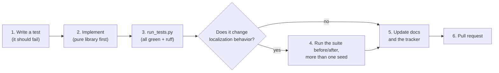

# 12. How to contribute

**Series:** [index](../README.md) · [1 Welcome](01_welcome.md) · [2 Setup](02_setup.md) · [3 Geometry](03_math_geometry.md) ·
[4 Uncertainty](04_math_probability.md) · [5 Field](05_field_model.md) · [6 Camera](06_camera.md) ·
[7 Particle filter](07_particle_filter.md) · [8 Which half](08_side_belief.md) · [9 Game and team](09_game_and_team.md) ·
[10 Testing](10_testing_and_evaluation.md) · [11 Progress](11_progress.md) · **12 Contributing**

You've seen the problem, the math, the code and the state of things. This chapter is the practical part: how to
pick something to work on, make the change, check it, and get it merged without breaking anything.

---

## 12.1 Ways to help

Not all contributions are code:

- **Code:** a ticket from the plan, a bug fix, a speed-up.
- **Tests:** a scenario nobody has tried, an edge case, a regression test for a bug you found.
- **Hardware sessions:** run the bench with real parts as they become available (a D435 on a tripod, the head
  encoders, the GameController on the field network) and record the sessions for replay.
- **Documentation:** if something in this series confused you, fixing it helps the next person.
- **Reviews:** read other people's changes, run them, and ask questions.
- **Decisions:** several tickets are blocked on team decisions (chapter 11, section 11.4).

## 12.2 Picking a task

1. **Open the status table** in the [implementation plan](../../implementation_plan.md) §6. Each ticket has a
   label:
   - 🤖 means it can be done with simulation alone;
   - 🔧 means it needs hardware;
   - 🧑 means it needs a decision first.
2. **Check its dependencies** ("Depends on"). Don't start a ticket whose dependencies aren't done, unless the work
   can be done against simulated inputs.
3. **Read the ticket's section** in the plan: goal, inputs, outputs, how to test it, and what "done" means.
4. **Tell the team** you're taking it, and put your name in the tracker row, so two people don't do the same work.

Good first tasks:

- write a test for a behavior you learned in chapters 5–9 that isn't tested yet;
- add a scenario to the suite (for example, a robot standing still while the head scans, or two falls in a row);
- improve a doc you found unclear;
- LOC-18 (feature projection), if you want a real ticket.

## 12.3 The git workflow

**git** keeps the history of every change. A **branch** is a separate line of changes. A **pull request** (PR) is a
request, made on GitHub, to merge your branch into another one, where teammates can review it first.

The localization code lives on the branch **`localization`**, not on `main`. So your work branches **from**
`localization` and merges **back into** `localization`:

```bash
git checkout localization
git pull                                   # get the latest
git checkout -b loc-18-feature-projection  # your own branch: ticket + short description
# ... edit, test ...
git add -A
git commit -m "LOC-18: project field features to the floor"
git push -u origin loc-18-feature-projection
```

Then open a pull request on GitHub with **base: `localization`** (not `main`).

The naming follows the team's existing convention in `td_perception` (branch `p-XX-short-desc`, commit
`P-XX: what changed`), using the `LOC-XX` ticket IDs until tickets are filed with real numbers.

Rules of thumb:

- **One ticket per pull request.** Small PRs get reviewed faster and break less.
- **Never commit directly to `main` or `localization`**; always go through a PR.
- **Never force-push** a branch other people use.
- Run `git status` before committing, and check you're not committing generated files (`reports/`, recordings, the
  venv). The [`.gitignore`](../../../.gitignore) covers the usual ones.

## 12.4 The development loop



1. **Test first.** Write a test that describes what the code should do, using synthetic data from the simulator.
   Run it and watch it fail; that proves the test actually tests something.
2. **Implement the library first, the ROS node last.** Libraries are pure Python + numpy with no ROS imports, take
   plain arrays and dataclasses, and are tested with pytest. A ROS node, when one is needed (LOC-20), is a thin
   wrapper that converts messages and calls the library. That's why everything here runs on a laptop.
3. **Run everything:** `python run_tests.py`. All tests pass and ruff is clean, or it's not done.
4. **If you changed the filter, the side belief or the simulator, run the suite** ([chapter 10](10_testing_and_evaluation.md))
   before and after your change, with at least two seeds, and compare. A change that helps one scenario and hurts
   another needs a discussion, not a merge.
5. **Update the docs:**
   - the ticket's row in the plan's status table (§6);
   - the [roadmap](../../roadmap.md) if the design changed;
   - this series if something here became wrong.
   If the change affects the test report, regenerate it with `python test_report/make_results.py`.
6. **Open the pull request** with the checklist below.

## 12.5 Code conventions

| Topic | Convention |
|---|---|
| **Style** | ruff, with the settings in [`ruff.toml`](../../../ruff.toml): line length 110, Python 3.10. `ruff check .` and `ruff format .` fix most things. |
| **Units** | SI everywhere: meters, radians, seconds. Convert degrees only for display. |
| **Frames** | Field frame: origin at the center mark, **own goal at −x**. Robot frame: x forward, y left. Say which frame a variable is in when it's not obvious. |
| **Angles** | Always wrapped to (−π, π]; differences computed with wrapping. |
| **Arrays** | Vectorize with numpy (no per-particle Python loops in hot paths). Note shapes in comments: `# (N, M)`. |
| **Randomness** | Every random generator takes a `seed`; tests always pass one. |
| **Settings** | In a frozen config dataclass ([`PFConfig`](../../../td_localization/td_localization/pf.py), [`SideConfig`](../../../td_localization/td_localization/side.py), …), each with a comment saying what it does and why it has that value. No unexplained numbers in the code. |
| **Comments** | Explain *why*, not *what*. The existing code is a good model: read a few docstrings in `pf.py` and `side.py`. |
| **Dependencies** | numpy only in the libraries; `td_game` uses only the standard library. Adding a dependency needs a reason and the team's agreement. |
| **Data** | Never commit recordings, images or model weights. Small reference reports are fine; big CSVs are git-ignored. |
| **Markdown** | When text names a class defined in this repository, link its first mention to the defining file (this repository's `CLAUDE.md` rule). |

## 12.6 Things you must not do without asking

Some changes affect other people, the robot's safety, or the team's position with the referees. Stop and ask the
team (the plan's §0.3 has the full list) before you:

- **change a team decision** in the plan's §9 log, for example the side consensus rule (`min_flip_sources`) or the
  IR policy;
- **change message definitions** other teams' code depends on (`td_msgs`);
- **write anything that commands motors or servos,** or touches motor, CAN or safety configuration;
- **turn the D435's IR projector on** (team policy: off);
- **upgrade ROS, JetPack, Isaac ROS or Docker images:** they're frozen through RoboCup 2027;
- **interpret the rules** in a way that matters, or send anything to the HSL Technical Committee;
- **edit `third-party/`** in this repository (it needs the owner's approval), or create a `results/` folder outside
  `robocup_rl/experiments/` (this repository's `CLAUDE.md` forbids it; that's why the report folder is called
  `test_report/`).

If something is unclear about the hardware (wiring, offsets, which encoder), ask rather than guess.

## 12.7 Pull request checklist

Copy this into your PR description:

```markdown
## What changed
<one or two sentences; the ticket ID>

## How it was tested
- [ ] `python run_tests.py`: all packages pass, ruff clean
- [ ] New or changed behavior has tests
- [ ] If filter / side belief / simulator behavior changed: suite before vs after, seeds: ...
      <paste the relevant rows of report.md>

## Docs
- [ ] Plan §6 status row updated
- [ ] Roadmap / getting-started docs updated if the design or behavior changed

## Follow-ups / decisions needed
<anything a human has to decide or do on hardware>
```

## 12.8 Reviewing a pull request

When someone asks you to review:

1. **Read the description.** Is it clear what changed and why?
2. **Check out the branch** and run `python run_tests.py`.
3. **Check frames, units and angle wrapping**: the most common bugs in this kind of code.
4. **For behavior changes, look at the suite numbers.** Did anything get worse? Was more than one seed run?
5. **Ask questions.** "Why this value?" is a fair question for any constant.

## 12.9 Working alongside AI agents

AI coding agents also work on this code. They follow the concise [agent track](../agents/README.md) of this series,
and leave a **handoff note** after each work session in [`docs/handoffs/`](../../handoffs/): what they did, what they
verified, and what's left. Read the newest handoff before picking up where an agent left off. Review an agent's
pull request exactly like a person's. You're welcome to write handoffs too; they're the quickest way for anyone to
pick up your work.

## 12.10 You're ready

You know the problem, the math, the code, how it's tested, where it stands, and how to change it. A good next step is
to pick one "Try it" exercise you skipped, run it, then change something and predict the result before you run it
again. That habit (predict, then measure) is how this code was built.

When you're stuck, ask the team. And when something in this series was wrong or unclear, fix it: that's a
contribution too.

---

**Back to:** [the series index](../README.md) · [the localization README](../../../README.md)
