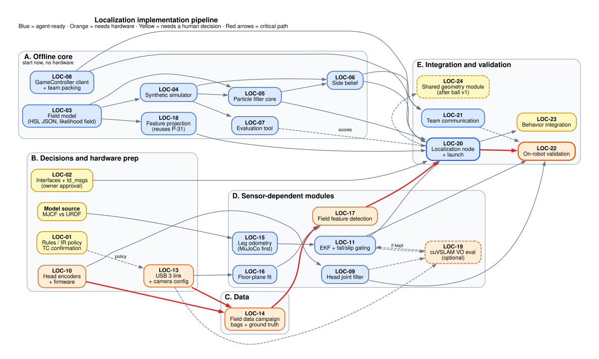

# Localization implementation plan (for agents)

**Written:** 2026-10-26.
**Status:** proposal. No ticket below has been filed or approved yet.
**Read first:**
- [roadmap.md](roadmap.md): the why, the rules and the design (§3.5 fusion and side handling).
- `td_perception/CLAUDE.md`: the repo's hard rules.

[Graphviz source](figures/implementation_pipeline.dot)

This plan turns the roadmap into tickets an agent can pick up. Each ticket says:
- where the code goes and what it consumes and produces;
- how to test it and when it's done;
- what it depends on;
- whether an agent can finish it alone.

---

## 0. Rules for agents

### 0.1 Follow the target repo's conventions

Most work lands in `td_perception`. Its `CLAUDE.md` is binding there. In short:

- **Workflow:**
  - Branch `p-XX-short-desc`, commit `P-XX: what changed`, one ticket per PR.
  - The PR says what changed, how it was tested (bag names or rig test) and metrics where relevant.
- **Environment:**
  - Everything runs in the dev container: `make dev`, `make build`, `make test`, `make lint` (ruff, line length 110, py310).
  - Never install anything on the host.
  - A new dependency goes into **both** Docker images and the lockfile, with the reason in the PR.
- **Code:**
  - Python (rclpy) nodes. C++ only if profiling proves Python is the bottleneck.
  - Pure-logic modules get pytest unit tests with synthetic data.
- **Frames and time:**
  - SI units, REP-103/105/120 frames.
  - Carry the image stamp end to end; TF lookups use the image stamp, never `now()`.
  - No blocking calls in callbacks.
- **Data:** never commit bags, images, weights or engines. Use the shared drive plus manifests.

In `embedded`, follow its README and existing package layout under `humanoid_control/`.

### 0.1a Where this code lives now

- The packages were written in a local staging workspace (2026-10-26 to 10-29) and moved to the `localization`
  branch of `robocup-simulations`, under `localization/`, for team review. The final home is still open: the
  packages mirror the `td_perception` layout (ament_python), so they can move there once the team decides
  (§1, §8).
- Test with a plain Python venv (Python 3.10, numpy 1.21.5 to match Ubuntu 22.04 / ROS Humble; pytest, ruff).
  Docker wasn't available while writing them. See [`../README.md`](../README.md).
- **End every agent run with a new timestamped handoff** in [`handoffs/`](handoffs/). If you're about to hit a
  usage limit, write a short one immediately. Older handoffs describe the original workspace (`<workspace>`,
  `localization_work/`), which maps to this folder.

### 0.2 Pattern for every localization module

1. **Pure library first:** numpy only, no ROS imports. It takes plain arrays and dataclasses.
2. **Tests next to it,** using synthetic data from the simulator (LOC-04) where possible.
3. **Thin ROS node last:** subscribe, convert, call the library, publish. Parameters in YAML.

This matters because the `td_perception` code base is unsettled. `main` and the `p-33-ball-tracker` branch have
diverged (roadmap §1.4). Pure libraries survive either outcome; only the thin nodes would move.

### 0.3 Stop and ask a human when

- **A `td_msgs` change** (new or changed message). Other teams build against it, and the owner must approve.
- **Anything that commands motors or servos,** or changes motor, CAN or safety config in `embedded`.
- **The D435 IR projector would be on.** Team policy is projector off; never set `emitter_enabled` to 1.
- **A version upgrade** (ROS, JetPack, Isaac ROS, Docker base image). Images are frozen through RoboCup 2027 (roadmap §4.3).
- **Merging or rebasing `p-33-ball-tracker`,** or deleting packages on `main`.
- **Unclear hardware state:** wiring, which encoder, measured offsets. Ask; don't guess.
- **Rules interpretation or anything sent to the HSL TC.** Agents draft; humans send.
- **Changes to `test_frozen` data** or labels.

### 0.4 Ticket IDs

IDs below are `LOC-xx` placeholders. When a ticket is filed in `td_perception`, use the next free `P-XX` there; the
roadmap currently uses up to P-50. Record the mapping in the status table (§6). Tickets landing in `embedded` follow
that repo's practice.

### 0.5 Labels used below

| Label | Meaning |
|---|---|
| 🤖 **Agent-ready** | An agent can finish it with synthetic data or existing repos alone |
| 🔧 **Needs hardware** | Needs the Jetson, D435, robot, field or recorded bags; a human runs or supervises the hardware part |
| 🧑 **Needs decision** | Blocked on a human or team decision; an agent may draft the decision memo |

---

## 1. Where the code goes

| Package (proposed) | Repo | Contents |
|---|---|---|
| `td_field_model` | td_perception | Pure library: HSL field geometry from the rules JSON, landmarks, likelihood field, mirror helpers. Also the synthetic observation simulator. |
| `td_field_features` | td_perception | Field/line segmentation adapter, depth mask, feature extraction, floor-plane fit, projection to `base_footprint`. Library plus node. |
| `td_localization` | td_perception | Particle filter, side belief, localization node, launch and config, evaluation tool |
| `td_game` | td_perception (or a shared repo, see LOC-02) | GameController client, team message packing and budget accounting |
| `td_msgs` additions | td_perception | `LocalizationState`, possibly `FieldObservations` and `GameState`. **Owner approval required.** |
| `humanoid_state_estimation` | embedded (`humanoid_control/`) | Leg odometry, fall/slip gating, `robot_localization` EKF config |
| Head MCU firmware | embedded (`imu_process/head_mcu/`) | Pan/tilt encoder readout added to the existing micro-ROS sketch |
| Head joint filter | td_perception (`td_head_control` or a new `td_head_state`) | Encoder + head IMU fusion, publishes `neck_yaw`/`neck_pitch` |

**Reuse; don't copy:**
- `td_ball_tracker/projection.py`: `project_to_ground(u, v, K, T_ground_cam, plane_z, D)` with `plane_z=0` projects
  line pixels. `projection_covariance()` gives the xy covariance.
  - Import it at first.
  - Moving it into a shared geometry module is a separate ticket (LOC-24), because it touches ball-tracker code.
- `embedded/humanoid_control/humanoid_safety/.../pinocchio_backend.py`: Pinocchio is already a dependency, so leg
  forward kinematics can use it.
- `embedded/imu_process/fall_detector.py`: `IMUFallDetector`, the existing fall detector.

---

## 2. The pipeline at a glance

The work runs in five stages. Stage A can start today, with no hardware and no decisions.

| Stage | What | Tickets | Blocked by |
|---|---|---|---|
| **A. Offline core** | Field model, simulator, particle filter, side belief, GameController parsing, evaluation metrics, team packing | LOC-03 to LOC-08 | Nothing |
| **B. Decisions and hardware prep** | IR policy confirmation, interfaces, head encoders, USB 3, odometry model source | LOC-01, LOC-02, LOC-10, LOC-13 | People and parts |
| **C. Data** | Field bags with ground truth, labeled line frames | LOC-14 | USB 3 link, a field, an operator |
| **D. Sensor-dependent modules** | Head joint filter, floor plane, leg odometry, EKF, features, projection, cuVSLAM evaluation | LOC-09, LOC-11, LOC-12, LOC-15 to LOC-19 | B and C |
| **E. Integration and validation** | Localization node, launch, replay eval, on-robot tests, team comms, behavior hooks | LOC-20 to LOC-23 | A and D |

**Critical path:**
LOC-13 (USB 3) and LOC-10 (head encoders) → LOC-14 (field bags) → LOC-17 (features) → LOC-20 (localization node)
→ LOC-22 (on-robot validation).

**Parallel lanes:**
- Stage A (agents) runs alongside Stage B (people).
- Leg odometry (LOC-15) can be developed in MuJoCo before the real encoders are calibrated.

---

## 3. Stage A: offline core (🤖 agent-ready now)

### LOC-03 Field model (`td_field_model`)

- **Goal:** one source of truth for field geometry, built from the official rules files.
- **Input:** `HSL-Rules/figs/FieldGenerator/field_hsl_{s,m,l}_2026.json`.
  - Vendor a copy into `td_field_model/config/` with its source tag (`rules-2026-v1.1.1`) and sha256.
  - Don't read from a sibling checkout at runtime.
- **Build:**
  - `FieldModel.from_json(path)`, with:
    - line segments, center circle, corner arcs and penalty marks;
    - goalpost positions (inner width plus post diameter) and the field boundary;
    - **typed landmarks:** L, T and X crossings, center mark, penalty marks, posts.
  - Frame: origin at the center mark, +x toward the opponent goal (own-goal relative, roadmap §3.2).
  - Remember the JSON dimensions are measured to the outside of lines (lines belong to the area they enclose).
  - `likelihood_field(resolution=0.02, margin=1.0)`: a distance-to-nearest-line grid covering the field plus border
    strip, with bilinear lookup. Cache it to `.npz`.
  - `mirror(pose)`: the 180° rotation `(x, y, θ) → (−x, −y, θ+π)`.
- **Tests:**
  - Dimensions match the JSON for S, M and L.
  - Every landmark lies on lines.
  - The distance field is 0 on lines and correct at sample points.
  - The mirror is an involution, and mirrored landmarks map onto landmarks.
- **Done when:** M and L load; the likelihood-field build is under 2 s and lookups are vectorized; tests pass in `make test`.

### LOC-04 Synthetic observation simulator

- **Goal:** realistic fake observations, so the filter and side logic can be tested without hardware. This is also
  the CI harness.
- **Build:** `td_field_model/sim.py`:
  - `render(pose, head_yaw, head_pitch, camera_model, field, rng) → Observations`.
  - Camera model: D435 RGB intrinsics (848×480, 69°×42°), height about 1.2 m.
  - Output: visible line points (sampled every N px), crossings with type, post bearings.
  - Noise from roadmap §2.3 and §3.4: range σ grows with d², bearing σ about 0.5°.
  - Optional realism:
    - occlusion by random robot discs;
    - false positives (white jerseys, other fields' lines beyond the boundary);
    - dropouts;
    - head pitch bias.
  - Trajectory generator: random walks, kick-off placements, penalty re-entry, falls (sudden heading noise),
    kidnaps.
- **Tests:**
  - With zero noise, the projected points lie on lines.
  - The visible set respects the field of view and range.
  - Seeded runs are deterministic.
- **Done when:** LOC-05/06 tests can run on generated scenarios in under 30 s total.

### LOC-05 Particle filter core (`td_localization/pf.py`)

- **Goal:** the layer 3 estimator, as a pure library.
- **Build:**
  - **State:** particles `(x, y, θ)` plus weights.
  - **Predict:** odometry change in the robot frame, with noise proportional to translation and rotation. Use
    larger noise when the odometry message carries inflated covariance (falls).
  - **Update:**
    - Line points: score each particle by its distances in the likelihood field, using a robust kernel (for
      example Cauchy) so outliers don't dominate.
    - Typed crossings: nearest same-type landmark.
    - Goalposts: bearing only.
    - Each measurement's σ comes from its covariance (`projection_covariance`).
  - **Resample:** low-variance, triggered by effective sample size.
  - **Injection:** sensor-reset injection of random particles, **restricted to the half the side belief says**.
  - **Output:** weighted mean of the best cluster, covariance, number of clusters, number of good matches.
- **Tests (on LOC-04 scenarios):**
  - Converges from a known half within 10 s of simulated time.
  - Meets roadmap §3.3 (p50 ≤ 0.2 m, p95 ≤ 0.5 m, heading p95 ≤ 5°) on clean and noisy runs.
  - Recovers from kidnaps within the same half.
  - **Never jumps to the mirror half on its own.**
- **Performance:** 500 particles × 200 points in ≤ 10 ms in numpy on a laptop. Record the Jetson number later in LOC-20.
- **Done when:** tests pass and a short design note sits in the module docstring.

### LOC-06 Side belief (`td_localization/side.py`)

- **Goal:** the separate own-half vs mirrored belief from roadmap §3.5.
- **Build:**
  - Log-odds of "the particle filter's current half is correct". Inputs:
    - **Game events:** Initial-state seeding; penalty end gives two touchline hypotheses (both in the own half),
      which vision resolves.
    - **Continuity:** heading consistency against the gyro-integrated heading, and distance moved since the last
      confident fix.
    - **Teammates:** a mirrored ball match counts against; a direct match counts for. Weight the goalkeeper highest.
    - **Weak cues:** opponent positions at kick-off.
  - API: `flip_suggested()` fires only after sustained evidence. The node (LOC-20) then mirrors the particles and
    logs a loud event.
- **Tests:**
  - Scripted scenarios: kidnap, penalty re-entry from both touchlines, mid-field fall, a teammate disagreeing.
  - Zero wrong flips in clean scenarios.
  - Correct recovery when the evidence is real.
- **Done when:** flip metrics are reported by LOC-07.

### LOC-07 Localization evaluation tool (`td_localization/eval.py`, CLI in `tools/`)

- **Goal:** one script that scores any run: a simulator scenario now, field bags later.
- **Metrics:**
  - position and heading error at p50, p95 and max;
  - wrong-half time and flip count;
  - time to converge after each reset event;
  - update latency at p50 and p95.
- **Input:** estimated poses plus ground truth, timestamp-aligned, using the same alignment rules as
  `evaluation_perception/motion_eval.py` on the `evaluation_perception` branch. Reuse its approach if that branch merges.
- **Output:** a markdown report like the bake-off's `report.md`, plus JSON.
- **Done when:** LOC-05/06 tests call it, and it's documented in `docs/`.

### LOC-08 GameController client and team message packing (`td_game`)

- **Goal:** know game state, half, kick-off team and penalties; and pack team messages within the rules budget.
- **Build:**
  - **Read the official format; don't guess.** Use the HSL GameController repo headers in
    `game_controller_msgs/headers/` (<https://github.com/RoboCup-HumanoidSoccerLeague/GameController>).
  - Parse the 2 Hz broadcast. Send the required robot status replies.
  - Publish `/game/state`: a message in `td_msgs`, which needs approval, or `std_msgs` JSON as a stopgap. Mark that
    clearly.
  - **Team messages:**
    - At most 512 B payload, UDP broadcast on port 10000 + team number.
    - A budget accountant that counts messages sent in Ready, Set and Playing against 12,000 per game, adds
      600 per added minute and 6,000 for extra time, and throttles to stay under it.
- **Tests:** parse and serialize round trips against packet fixtures built from the official headers; budget math
  across a simulated game.
- **Done when:** it works against the official GameController in a local test (🔧 for that last step only).

---

## 4. Stage B: decisions and hardware prep

### LOC-01 Rules and policy confirmation (🧑 needs decision)

- **Agent:**
  - Draft the email to `hsl_tc@lists.robocup.org` asking to confirm passive IR stereo with the projector off, and
    use of IR frames for visual odometry.
  - Draft the `td_perception/CLAUDE.md` correction (it still says IR-left is illegal).
  - Draft the H_top measurement procedure that confirms the division.
- **Human:** sends the email, approves the CLAUDE.md edit, measures the robot.
- **Done when:** the answers are recorded in roadmap §2.2 and §1.3.

### LOC-02 Interfaces (🧑 needs decision)

- **Agent:** draft the following, marked DRAFT like P-05:
  - `LocalizationState.msg`:
    - header (`map`), status enum (`INITIALIZING`, `LOCALIZED`, `UNCERTAIN`, `LOST`);
    - pose plus covariance, `side_confidence`, `num_matches`, `num_clusters`, `last_reset_reason`.
  - Topics: `/localization/pose` and `/localization/state`, and TF `map → odom`.
  - Whether features cross a topic (`FieldObservations`) or stay inside one process. **Recommend one process at
    first** (features and filter in the same node) to avoid a new message and an extra image copy (see P-27).
  - Where `td_game` lives, since behavior also needs it.
- **Human:** the `td_msgs` owner approves.
- **Done when:** the interface doc is merged in `td_perception/docs/interfaces.md`.

### LOC-10 Head pan/tilt encoders (🔧 + 🧑)

- **Human:**
  - Choose encoders that fit the head size and weight rules: for example magnetic absolute encoders (AS5600 /
    AS5048-class) on each axis, or servos with position feedback.
  - Mount them and wire them to the head ESP32-S3.
  - Note the shared I²C bus (GPIO4/5), which already carries the IMU and PCA9685. Check address conflicts.
- **Agent:**
  - Extend `embedded/imu_process/head_mcu/humanoid_vision_microros.ino` to publish raw encoder angles with
    timestamps.
  - Update its README.
  - **Don't change servo output behavior.**
- **Done when:** angles stream at 100 Hz or more with a documented zero and sign. A human verifies on hardware.

### LOC-13 USB 3 link and camera config (🔧)

- **Human:** fix the D435 USB 3 link: cable, port or hub.
- **Agent:**
  - Add a startup check that fails loudly when `rs-enumerate-devices` shows USB 2.x.
  - Pin the realsense-ros launch to 848×480 @ 60 RGB plus aligned depth, **`depth_module.emitter_enabled:=0`**, with
    a guard that refuses to run if the emitter reads back as on.
- **Done when:** the Jetson streams both at the target rate. Record `tegrastats`.

### Odometry model source (🧑, part of LOC-15)

The legs exist as both the `robocup-simulations/robots/triton_humanoid` MJCF (which calls itself "single source of
truth for the robot model") and `embedded/humanoid_leg_description` URDFs. Leg odometry must use the same kinematics
as the real robot, so a human decides which is authoritative before LOC-15 lands.

---

## 5. Stages C–E

### LOC-14 Field data campaign (🔧, humans plus an agent for tooling)

- **Agent:**
  - Extend `tools/record.sh` with a localization profile: RGB, aligned depth, `/joint_states`, `/imu/data_raw`,
    `/head/imu`, head encoders, `/tf`.
  - Write a ground-truth protocol: taped grid points at measured field coordinates, with the robot or rig placed and
    rotated at each, plus walking runs past the markers.
  - Create manifests per the data rules.
- **Human:** records on a real or partial field in varied light, with distractors and another field's lines visible.
  Split by session. Freeze a test set the same way as the ball pipeline's `test_frozen`.
- **Done when:** the bags and ground truth are in `$TD_DATA` with manifests. An agent labels a line-segmentation subset,
  or a human reviews auto-labels.

### LOC-09 Head joint filter (🤖 logic, 🔧 verify)

- **Build:**
  - A per-axis complementary filter: encoder as the absolute, low-frequency part; head-minus-body gyro rate as the
    high-frequency part.
  - Publishes `neck_yaw`/`neck_pitch` on `/joint_states` (the `interfaces.md` contract) at 100 Hz or more, stamped at
    measurement time.
  - Separate consistency check: body IMU + leg chain + encoders should predict the head IMU's gravity direction.
    Log the residual and alarm above a threshold.
- **Tests:** synthetic encoder with noise and lag plus a gyro with bias. Output tracks the truth within 0.3° in
  steady state.
- **Depends on:** LOC-10 for real data.

### LOC-16 Floor-plane fit (`td_field_features/plane.py`) (🤖 logic, 🔧 tune)

- **Build:**
  - RANSAC plane fit on aligned depth within 1–4 m, below the horizon, on pixels labeled green field.
  - Outputs camera height, pitch and roll plus a quality score (inlier ratio, residual).
  - Gate on quality. When invalid, fall back to the joint TF.
- **Tests:** synthetic depth with noise that grows with distance squared, and outliers. Recovers pitch within 0.3°.
  Then compare against the head IMU on bags.
- **Done when:** on LOC-14 bags, pitch is within 0.5° of reference (roadmap L3).

### LOC-15 Leg odometry (`embedded/humanoid_control/humanoid_state_estimation`) (🤖 in sim, 🔧 on robot)

- **Build:**
  - Forward kinematics with Pinocchio on the authoritative model.
  - Choose the support foot from the lower foot height in `base_footprint` and the gait phase; there are no foot
    force sensors.
  - Body displacement comes from the support foot staying still. Publish a twist with covariance.
- **Develop in simulation first:**
  - Run the MuJoCo env in `robocup-simulations` (`.venv-mujoco`), log joint angles plus the true base pose, and score
    with LOC-07's metrics.
  - This needs a walking checkpoint (the `steering` experiment). If none exists, use scripted stepping motions, or
    ask for a checkpoint.
- **Done when:** in sim, drift is ≤ 10% of distance with the gyro providing yaw (roadmap L2). On the robot this is
  blocked on encoder calibration in `embedded`.

### LOC-11 EKF and fall/slip gating (🤖 config, 🔧 tune)

- **Build:**
  - `robot_localization` `ekf_node` config:
    - Leg odometry twist (LOC-15), body IMU yaw rate, and optionally visual odometry (LOC-19).
    - The walk command as a weak prior.
    - Publishes `odom → base_footprint` at 100 Hz.
  - Gating node:
    - Wraps `IMUFallDetector` and compares leg against gyro yaw rate.
    - On a fall or slip, inflates the twist covariance and emits a reset event for LOC-20.
- **Note:** check that `ros-humble-robot-localization` is in both Docker images first. If not, it's a new dependency
  and needs PR justification.
- **Done when:** on bags, `odom` never jumps and drift meets the LOC-15 targets.

### LOC-17 Field feature detection (`td_field_features`) (🔧 data, 🤖 code)

- **Segmentation:**
  - Extend the P-23a bake-off YOEO adapter to output the segmentation head (field / lines / background). Score it on
    LOC-14 labels.
  - If it's weak, train a small U-Net (training on a GPU box, export with `ml/deploy/export.py` on the Jetson, FP16).
- **Feature extraction:**
  - Line pixel sampling and skeletonization, with segment fitting.
  - Crossing classification (L/T/X), center-circle fit, penalty marks.
  - Goalpost bases from the detector.
- **Depth mask:** drop pixels above the floor plane (LOC-16) to reject robots and jerseys.
- **Tests:** synthetic images from LOC-04 geometry rendered to pixels for the logic; precision and recall on labeled
  bags for the model.
- **Done when:** feature precision and recall are reported, and projected feature error is ≤ 0.15 m within 4 m
  (roadmap L3).

### LOC-18 Feature projection (🤖)

- **Build:** call `project_to_ground(..., plane_z=0.0)` and `projection_covariance()` from `td_ball_tracker.projection`.
  - Use the camera transform at the image stamp: the measured floor plane when valid, otherwise TF.
  - Use bearing-only beyond 4 m.
  - Output observations in `base_footprint` with per-point covariance.
- **Tests:** round trip against LOC-04 projections, plus covariance sanity.

### LOC-19 cuVSLAM visual odometry evaluation (🔧, roadmap L2b)

- **Build:**
  - Isaac ROS 3.2 cuVSLAM, stereo-inertial, on the D435 IR pair (projector off) plus the head IMU, on the Jetson.
  - Subtract head motion using LOC-09 to get body velocity.
  - Fuse into the LOC-11 EKF behind a parameter.
- **Gates:**
  - It's a new heavy dependency, so add a separate Jetson image layer and justify it in the PR (images are frozen
    otherwise).
  - Profile alongside the TensorRT detector.
- **Done when:** a keep-or-drop decision is recorded, with drift and compute numbers against LOC-15 + gyro alone.

### LOC-20 Localization node and launch (`td_localization`) (🤖 code, 🔧 run)

- **Build:**
  - One node (per the LOC-02 recommendation) that:
    - runs feature extraction (LOC-17/18) and the filter (LOC-05), plus side belief (LOC-06) and game events (LOC-08);
    - publishes TF `map → odom`, `/localization/pose` and `/localization/state`;
    - writes the image stamp end to end;
    - runs the heavy work off the callback thread;
    - takes parameters from YAML.
  - Launch is included from `td_head_bringup` with `body:=rig|sparky` differences in config only. **No code branches
    on the body.**
  - Foxglove panels: particles, matched features and side confidence.
- **Done when:** runs on LOC-14 bags at 15 Hz or more on the Jetson with the detector running, and LOC-07 meets roadmap
  §3.3 on the frozen test bags.

### LOC-21 Team communication (🤖 logic, 🔧 field test)

- **Build:**
  - Pack pose, ball in `map`, side confidence and role into ≤ 512 B, sent at about 2 Hz via the LOC-08 budget accountant.
  - Receive teammates' messages and feed LOC-06.
  - Goalkeeper role flag.
- **Done when:** a simulated game stays under budget with margin, and a two-robot (or two-laptop) test passes.

### LOC-22 On-robot validation (🔧)

- **Tests:**
  - Full pipeline on Sparky, walking.
  - Scripted kidnaps, penalty re-entry from both touchlines, falls, light changes, distractors.
  - 30-minute soak with thermals logged.
- **Done when:** roadmap §3.3 targets are met on a physical field, with zero wrong-half events.

### LOC-23 Behavior integration (🧑 + 🤖)

- **With the behavior owners:**
  - Ready-state positioning uses `/localization/pose`.
  - Shot guard when side confidence is low.
  - Behavior when `LOST` (search, scan, look at landmarks).
- **Agent:** provide the API and examples; behavior owners decide policy.

### LOC-24 Shared geometry module (🧑 approval, 🤖 code)

Move `projection.py` from `td_ball_tracker` into a shared module used by both the ball and localization pipelines.
Pure refactor with an unchanged API; the ball-tracker owner approves. Do it only after the ball v1 milestone
(2026-11-29) so it doesn't disrupt that sprint.

---

## 6. Status tracker (keep this updated)

Agents: update the row when you start, open a PR, or finish. Put the real `P-XX` once filed.

| ID | Title | Label | Depends on | Status | Filed as | Branch / PR |
|---|---|---|---|---|---|---|
| LOC-01 | Rules and policy confirmation | 🧑 | – | not started | | |
| LOC-02 | Interfaces and messages | 🧑 | – | not started | | |
| LOC-03 | Field model | 🤖 | – | **code + tests done locally** (46 pass), on the `localization` branch of robocup-simulations | | `localization/td_field_model` |
| LOC-04 | Synthetic simulator | 🤖 | 03 | **code + tests done locally** (32 tests, 78 in package), on the `localization` branch of robocup-simulations | | `localization/td_field_model` (`sim.py`, `scenarios.py`) |
| LOC-05 | Particle filter core | 🤖 | 03, 04 | **code + tests done locally** (25 tests), meets §3.3 targets in simulation; drift test added 2026-10-27 (same-half kidnap recovery 2–7/8 → 7/8); on the `localization` branch of robocup-simulations | | `localization/td_localization` (`pf.py`) |
| LOC-06 | Side belief | 🤖 | 04, 05 | **code + tests done locally** (17 tests), on the `localization` branch of robocup-simulations | | `localization/td_localization` (`side.py`) |
| LOC-07 | Evaluation tool | 🤖 | 04 | **code + tests done locally** (25 tests); scenario suite + reference reports; on the `localization` branch of robocup-simulations | | `localization/td_localization` (`eval.py`, `suite.py`) |
| LOC-08 | GameController client + team packing | 🤖 | – | **code + tests done locally** (36 tests in `td_game`, 5 bridge tests), loopback-tested only, on the `localization` branch of robocup-simulations | | `localization/td_game`, `td_localization/game_bridge.py` |
| LOC-09 | Head joint filter | 🤖/🔧 | 10 | not started | | |
| LOC-10 | Head encoders + firmware | 🔧/🧑 | – | not started | | |
| LOC-11 | EKF + fall/slip gating | 🤖/🔧 | 15 | not started | | |
| LOC-13 | USB 3 link + camera config | 🔧 | – | not started | | |
| LOC-14 | Field data campaign | 🔧 | 13, 10 | not started | | |
| LOC-15 | Leg odometry | 🤖/🔧 | model source decision | not started | | |
| LOC-16 | Floor-plane fit | 🤖/🔧 | 13 | not started | | |
| LOC-17 | Field feature detection | 🔧/🤖 | 14, 16 | not started | | |
| LOC-18 | Feature projection | 🤖 | 03 | not started | | |
| LOC-19 | cuVSLAM VO evaluation | 🔧 | 09, 11, 13 | not started on hardware. Bench prep done locally: a cuVSLAM model (`SimVisualOdometry`), a `LiveVisualOdometry.push_pose()` input for real cuVSLAM output, and a visual-only test (`test_report/visual_only.html`). Finding: head scans faster than the 1.2 rad/s tracking gate drop VO about 20% of the time | | `localization/td_bench` |
| LOC-20 | Localization node + launch | 🤖/🔧 | 02, 05, 06, 08, 11, 17, 18 | not started | | |
| LOC-21 | Team communication | 🤖/🔧 | 08, 06 | **code + tests done locally** (TeamComm, multi-robot sim, consensus rule); field test 🔧 still open; on the `localization` branch of robocup-simulations | | `td_game/team_comm.py`, `td_localization/team_sim.py` |
| LOC-22 | On-robot validation | 🔧 | 20, 09, 11 | not started | | |
| LOC-23 | Behavior integration | 🧑/🤖 | 20 | not started | | |
| LOC-24 | Shared geometry module | 🧑/🤖 | ball v1 done | not started | | |
| LOC-25 | Bench harness (partial hardware) | 🤖/🔧 | 05, 06, 08, 21 | **code + tests done locally** (31 tests): each input (camera, odometry, head, GameController, teammates, ball) can be real, recorded or simulated; record/replay; CLI; visual-only mix (cuVSLAM model + encoder/IMU head model); results report in `localization/test_report/`. Its line-pixel detector is a bench stand-in, not LOC-17. RealSense path untested (no D435 here); on the `localization` branch of robocup-simulations | | `localization/td_bench` |

(LOC-12 is intentionally unused: the old odometry-model item is folded into LOC-15.)

---

## 7. How an agent works a ticket

1. **Read:** this plan's ticket, roadmap §3.5, the target repo's `CLAUDE.md`, and the files the ticket names.
2. **Check:** that dependencies are done (§6) and no 🧑 decision blocks it. If blocked, write the decision memo instead.
3. **Branch** in the target repo per its convention. Never commit to `main` directly.
4. **Test first:** write tests with synthetic data (LOC-04) for the pure library.
5. **Implement the library,** then the thin node. Keep body-specific values in config.
6. **Run** `make lint` and `make test` in the dev container. For bag-based work, run replay and attach LOC-07 numbers.
7. **Open a PR:** what changed, how it was tested, metrics, and any 🧑 follow-ups.
8. **Update** the §6 row and, if the design changed, the roadmap. Record anything a future agent needs in the
   ticket section here, not only in the PR.

---

## 8. Risks that change this plan

| Risk | Effect | What to do |
|---|---|---|
| TC rejects passive-IR use | Floor plane and visual odometry lose their input | RGB-only mode: plane from head IMU + encoders. Drop LOC-19. Consider a visible-light stereo camera. |
| Head encoders slip or are late | Projection error at range (roadmap §2.3) | Use the floor plane plus head IMU for tilt. Limit pan speed during localization. |
| Leg encoders stay uncalibrated | No leg odometry | Commanded-velocity odometry plus gyro as a fallback, with a large covariance. |
| `td_perception` code-base split unresolved | Unclear where nodes live | Keep libraries pure (§0.2). Postpone node wiring (LOC-20). |
| Orin Nano compute is too tight | Rate or latency misses | Profile early (LOC-20). Reduce particles and points. Move hot loops to C++ only with profiling evidence. |
| 2027 rules change field or sensors | Map or sensor changes | The field model is config-driven (LOC-03). Recheck roadmap §2. |

---

## 9. Team decisions (log)

Decisions made by the team, as opposed to agent proposals. Agents: don't change these without asking a human.
Add new ones at the bottom with the date.

| Date | Decision | Why | Where it lives |
|---|---|---|---|
| 2026-10-26 | No GitHub writes; new code in `localization_work/` only; timestamped handoff at the end of each run | Review before anything reaches the team's remotes | workspace `CLAUDE.md`, §0.1a (superseded 2026-10-29) |
| 2026-10-29 | Move the work to `robocup-simulations`, branch `localization`, folder `localization/` | Share it with the team for review; final home still open | §0.1a, [`../README.md`](../README.md) |
| 2026-10-26 | IR policy: D435 projector off; passive IR stereo allowed; active-IR RGB-D not allowed | Stricter than the 2026 rule text, in line with where the rules are heading | roadmap §2.2 (TC confirmation still open, LOC-01) |
| 2026-10-27 | **Side consensus rule:** a robot flips halves only on evidence from the goalkeeper or from ≥ 2 different teammates within 15 s | One confidently-wrong teammate must never flip a healthy robot. Accepted cost: with no goalkeeper and one teammate, teammates can't flip a robot; it stays unsure (no shots) until a game event re-seeds it. | roadmap §3.5; `SideConfig.min_flip_sources = 2`, `flip_sources_window = 15.0` in `td_localization/side.py`; tests in `test_team_sim.py` |
