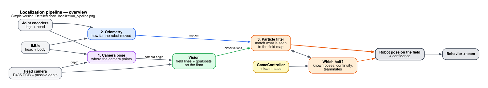
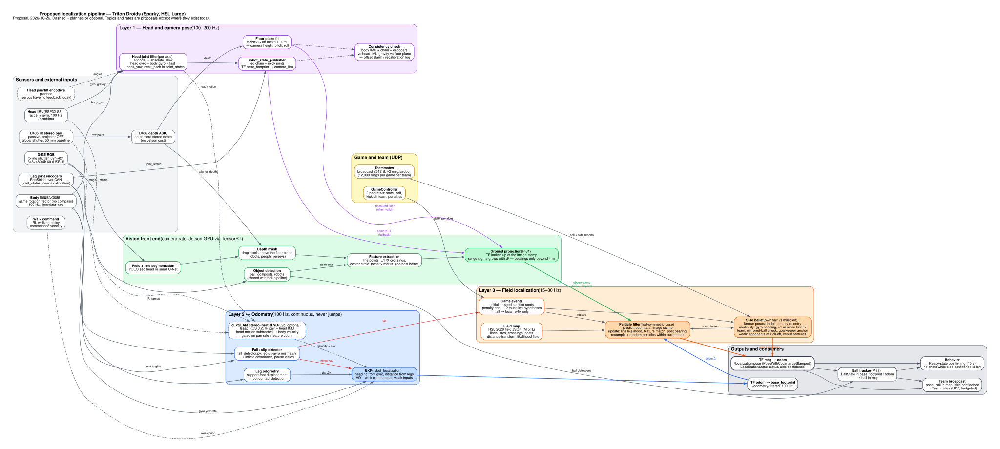

# Localization: current state and roadmap

**Written:** 2026-10-26 by Claude, from a review of the Triton Droids repos and the HSL 2026 rule book.
**Revised:** 2026-10-26.
- Team IR policy: active-IR RGB-D is not allowed; passive IR stereo is allowed (§2.2).
- Added §1.3 league facts, §3.4 using depth, §3.5 fusion and side design, §3.6 cuVSLAM assessment with
  performance numbers, and §4.3 upgrade policy.
- `map` is now own-goal relative, with no half-time flip.
- Head angles come from future joint encoders plus the head IMU.
**Audience:** team members and AI agents working on Triton Droids perception, control or behavior.
**Status:** proposal. Nothing here has been agreed by the team yet.

Repos reviewed (cloned next to this file's parent folder):

| Repo | Branch / commit reviewed | What it is |
|---|---|---|
| `embedded` | `Humanoid_ros2` @ `3159493` | ROS 2 robot stack: motors, IMU firmware, safety, head vision |
| `td_perception` | `main` @ `f26bbfd`, plus all branches | Head ball-perception module (v1 due 2026-11-29) |
| `robocup-simulations` | `main` @ `4bfbefa` | RL training on NVIDIA ProtoMotions |
| `HSL-Rules` | `rules-2026-v1.1.1` @ `06c44d4` | RoboCup Humanoid Soccer League rule book |

---

## 1. Findings

### 1.1 There is no localization of any kind yet

All branches of all three team repos were searched for SLAM, vSLAM, localization, AMCL, particle filter,
visual odometry, RTAB-Map, Cartographer, nav2 and robot_localization. Nothing implements any of them.

- **`embedded`:**
  - The only odometry is `/odom` from the deprecated serial IMU reader
    (`imu_process/Attitude_Sensing(Depreciated)/.../imu_reader_node.py`). The README says it is IMU dead
    reckoning and "not an independently measured robot position".
  - The body IMU gives orientation with drifting yaw and no absolute heading.
- **`td_perception`:**
  - `docs/interfaces.md` reserves `odom → base_footprint` for a "state estimator (torso IMU + leg kinematics)".
    Nothing provides it. On the v1 tripod rig it is a static identity transform.
  - There is no `map` frame.
  - `docs/rules.md` notes that balls beyond the 9 m detection range need "team communication and localization".
- **`robocup-simulations`:** the only experiment (`steering`) uses the simulator's true body pose. Nothing is
  estimated, and there is no field, goal or camera in the sim.
- **No repo has a GameController client.** Localization needs one to know the game state, the half and the
  kick-off side (§2.4).

### 1.2 Hardware relevant to localization

| Item | State today | Effect on localization |
|---|---|---|
| Head camera | Intel RealSense D435. RGB 69°×42°, rolling shutter. The camera has a **USB 3.2 Gen 1 Type-C** port, but the tested Jetson setup enumerated it at **USB 2** (640×480 @ 15 FPS, per `embedded/docs/humanoid_vision_instructions.md`). That points to the cable, hub or port. | Main input for line and goalpost detection. Use a USB 3 cable and port to get 848×480 @ 60 FPS or higher resolutions with depth. |
| D435 IR stereo / depth | Two global-shutter imagers (OV9282, no IR-cut filter, roughly 400–865 nm) 50 mm apart, plus an IR dot projector. The on-board ASIC computes depth, so it costs the Jetson nothing. | **Team policy: projector off.** Passive IR stereo (depth and IR frames) is allowed; active-IR RGB-D is not (§2.2). Depth is useful within about 4 m, mainly for fitting the floor plane (§3.4). The IR pair also supports stereo VO (§3.6). |
| Body IMU | BNO085 on an ESP32-S3. `/imu/data_raw`, 100 Hz, `GAME_ROTATION_VECTOR`. | Good. The game rotation vector does not use the magnetometer, so it is rule-compliant. Yaw drifts. |
| Head IMU | MPU-family chip on the head ESP32-S3, `/head/imu`, accel + gyro only | Optional. Can help timestamp head motion. |
| Head pan/tilt | DS3225 hobby servos on PCA9685 channels 8 (pan) and 12 (tilt) (`td_perception` branch `p-33-ball-tracker`). **No position feedback today. Plan: add joint encoders, fused with the head IMU.** | Until encoders exist, the camera pose is only a commanded guess, and 1° of pitch error = 0.5 m range error at 6 m (§2.3). With encoders + head IMU (§3.5 layer 1) this blocker goes away. The depth floor plane is an extra check on tilt. |
| Leg joints | RobStride RS-02/03/04 over CAN, with encoder feedback | Leg odometry is possible, but encoder offsets are still zero and uncalibrated. |
| Compute | Jetson Orin Nano (planned), shared with the TensorRT ball detector | Everything must run on board (§2.5). Localization must fit in the CPU time the detector leaves. |

### 1.3 League and robot facts from the repos

- **League:** RoboCup 2027 Humanoid Soccer League (HSL), formed in 2026 by merging the Humanoid League and
  SPL. **Large division**, which uses a FIFA size 5 ball. Source: `td_perception/CLAUDE.md` and `docs/rules.md`.
- **Robot ("Sparky"):**
  - About 1.3 m tall with 20 DoF. The Middle division limit is 1.25 m.
  - The legs-only CAD/sim model is 16 kg plus a 0.5 kg placeholder. Full-robot mass is not recorded anywhere.
- **Division and height:**
  - 1.3 m is only 5 cm over the Middle limit, and the rules measure H_top with the head tilted up to its
    maximum or to the horizon, whichever is lower.
  - If the measured H_top came in at 1.25 m or less, Sparky would be Middle: size 3/4 ball, S- or M-Field.
  - **The sensor rules are the same in every division**, so the division doesn't change camera or depth
    legality.
- **Compute:** Jetson Orin Nano (8 GB SKU still to confirm), JetPack 6.2, ROS 2 Humble.
- **Hardware:**
  - Head: D435 on DS3225 pan/tilt servos driven by a PCA9685, with an ESP32-S3 head MCU and an MPU-family IMU.
  - Body: BNO085 IMU on an ESP32-S3.
  - Legs: RobStride RS-02/03/04 motors on CAN.
- **There is no BOM.** The `td_perception` replicability checklist still lists "BOM sheet, CAD in repo" as
  not done.

### 1.4 Perception code status that matters here

- `td_perception` `main` has ground-plane projection (P-31) and a Kalman ball tracker (P-33), both
  unit-tested in pure numpy. **Projecting field-line pixels to the floor reuses P-31 directly.**
- The working hardware head tracker is on branch `p-33-ball-tracker`. It is a different code base (C++
  `humanoid_vision`) and would delete `main`'s packages if merged as is. Localization should build on
  whichever design the team keeps; this document assumes `main`'s layout and frame contract.
- The detector bake-off (P-23a) already lists Bit-Bots YOEO-X. Per Bit-Bots' published work, YOEO also
  outputs field and line segmentation, but our adapter ignores that output today. **One network could serve
  both ball detection and line detection.**

---

## 2. Rule constraints (HSL Rule Book 2026 v1.1.1)

Recheck all of these when the 2027 rules come out.

### 2.1 Field

Sparky is about 1.3 m tall, which puts it in the **Large division**. Large plays on the **M-Field or the L-Field**.

| | M-Field | L-Field |
|---|---|---|
| Length × width | 14 × 9 m | 22 × 14 m |
| Diagonal | 16.6 m | 26.1 m |
| Line width | **0.05 m** | 0.12 m |
| Goal area (length × width) | 1 × 4 m | 1 × 5 m |
| Penalty area | 3 × 6 m | 3.5 × 7 m |
| Penalty mark distance | 2.0 m | 2.5 m |
| Center circle diameter | 3.0 m | 4.0 m |
| Corner arc radius | 0.5 m | 1.0 m |
| Goal inner width × height | 2.4–2.6 × 1.5–1.9 m | 2.6–3.1 × 1.8–2.0 m |
| Border strip (min.) | 1.0 m | 1.0 m |

- Exact 2026 values are in `HSL-Rules/figs/FieldGenerator/field_hsl_{m,l}_2026.json`. **Use those files as the
  map**, and make the field model a config so it can switch between M and L.
- Lines are white on green turf. Goalposts and crossbar are white, 7–12 cm wide. **Both goals look the
  same.** Nets may be white, gray or black.
- **The field is point-symmetric.** Nothing on the field tells the two halves apart.
- **Adjacent fields can be visible.** Barriers are only required when fields are closer than 3 m. Expect
  other fields' lines, goals and balls in view.
- **Lighting is not controlled:** at least 300 lux, white light, windows encouraged, shadows and glare
  possible, and it can change during a match.

### 2.2 Sensors (§ Sensors, Table "approved sensor types")

- Cameras must be in the head. Combined field of view at most 220° × 160°. With head motion, at most
  340° × 220°.
- **Cameras may only use light visible to humans.** This applies to the *visual perception* sensors, the
  images the robot "sees" with.
- **Depth devices are covered by a separate paragraph:**
  - "Passive integrated devices that provide dense depth information, such as stereo cameras, are permitted
    and encouraged."
  - "Active integrated devices ... such as cameras with an active infrared projector or time-of-flight cameras,
    are permitted but discouraged. Their use might be prohibited in the future."
  - The sensor table lists **"Active RGB-D based on infrared projection"** as approved: not human-like,
    discouraged.
- **Team policy (stated by the team on 2026-10-26):** active-IR RGB-D is **not allowed**, and passive IR is
  **allowed**. This is stricter than the 2026 text, which calls active depth "permitted but discouraged".
  Following the stricter reading is safe, because it's the direction the rules are heading.

  | D435 use | Team policy |
  |---|---|
  | RGB stream | Allowed |
  | Depth with the projector on (active IR) | **Not allowed** |
  | Depth with the projector off (passive IR stereo) | Allowed. This is the "passive integrated devices ... permitted and encouraged" category. |
  | IR imager frames with the projector off (for example stereo visual odometry) | Allowed as passive IR |

  Disable the projector in the realsense-ros launch (`depth_module.emitter_enabled:=0`). Add a startup check
  that refuses to run if the emitter is on, so a default setting can't make the robot non-compliant.

- **History:**
  - Older Humanoid League rules banned all active sensors except sound. The HL chair said in 2015 that the
    RealSense projector was not allowed.
  - Recent HL guidelines for sponsored robots (Fourier, Booster, Unitree) required physically covering the
    active part of cameras such as the RealSense.
  - The 2026 HSL text relaxed this. Git history shows the active RGB-D row went from "conditionally, under
    discussion" (Nov 2025) to "discouraged" in v1.1.1.
- Keep a mode that works on RGB alone in case passive-IR use is ever challenged at inspection. The
  visible-light-camera sentence is the clause someone could point to.
- **Conflict to resolve:** `td_perception/CLAUDE.md` says "IR-left (global shutter) is NOT a legal game stream",
  which contradicts this team policy. Update one or the other so agents don't get opposite instructions. A
  written TC confirmation (L0) settles it.
- **IMU allowed, compass not.** Magnetometers must be disabled and unused. Our BNO085 game rotation
  vector already complies. Never switch it to `ROTATION_VECTOR`, which fuses the magnetometer.
- Joint encoders, motor current and other internal sensing are allowed.
- **No LiDAR beyond 1D range sensors.** At most four 1D distance sensors, close range only, discouraged.

### 2.3 Range accuracy from a monocular camera

Projecting a pixel onto the floor gives range error ≈ `d² · Δθ / h`, where `h` is camera height and `Δθ` the pitch error.
With `h ≈ 1.2 m` and `Δθ = 1°`:

| Distance | 3 m | 6 m | 9 m |
|---|---|---|---|
| Range error | 0.13 m | 0.52 m | 1.18 m |

- Field lines seen across the view get very thin. A 5 cm M-Field line at 6 m spans about 0.1° vertically,
  roughly one pixel at 640×480.
- **Consequences:**
  - Weight line points by distance.
  - Use bearings, not ranges, for far features like goalposts.
  - Get accurate head joint angles (encoders + head IMU).
  - Fix the USB 3 link so the D435 can run 848×480 @ 60 or 1280×720 @ 30.

### 2.4 Game rules that drive localization

- **Ready state:** 45 s for robots to walk autonomously to legal kick-off positions. All robots must end in
  their own half. Only the kicking team's kicker may be in the center circle. At most three robots in their own
  goal area. Failing this gives an **Illegal Position** removal penalty.
- **Initial state:** handlers place robots. Robots may move their heads and calibrate but not walk.
  **Use this to converge before Ready.**
- **Teams change sides at half-time.** Handlers re-place the robots. With the own-goal-relative `map` frame
  (§3.2), nothing in the robot needs to flip.
- **Penalty re-entry:** the robot is placed outside the field on the touchline, level with the penalty mark
  of **its own half**, facing the opposite touchline. The rule book says the robot is kept in its own half
  "so that the symmetry of the field can be resolved by the robot's localization system".
  This is a known-pose re-initialization.
- **Match length:** 2 × 10 min halves.
- **Team size (Large):** 3 robots (Foundation) or 5 (Advanced).

### 2.5 Communication and compute

- **No off-board sensing or processing.** Localization runs on the robot.
- **Team messages:**
  - UDP broadcast through the field access point, on port 10000 + team number.
  - At most 512 B payload.
  - **At most 12,000 messages per team per game**, counted in Ready, Set and Playing. That works out to
    about 10 messages/s for the team, so about 2 msg/s per robot with 5 robots or 3 msg/s with 3.
  - The rules say this limit will be lowered in the future.
- **GameController:** sends 2 packets/s. Robots must answer it.
- **Debug:** at most 1 packet/s per robot, sent to a team device on the wired network.

---

## 3. Approach

### 3.1 Recommendation: map-based particle filter, not generic vSLAM

Use **Monte Carlo localization (a particle filter) against the known field map**, with field lines,
line intersections, the center circle, penalty marks and goalposts as measurements, and leg/IMU odometry
as the motion model. This is the standard method in the league; Bit-Bots, B-Human and other teams use
variants of it.

Generic vSLAM (ORB-SLAM3, RTAB-Map, Isaac ROS cuVSLAM and similar) does not fit the problem:

- **The map is already known and fixed by the rules.** Nothing needs to be mapped.
- **Few stable visual features:**
  - The turf is repetitive green, and the lines repeat.
  - Most texture is moving robots, people and other fields, which change between venues and during a match.
- **Symmetry.** A loop closure or relocalization on a point-symmetric field can snap to the mirrored pose.
  That is the most damaging error possible (own goals, Illegal Position).
- **Depth-only methods** (ICP, depth odometry) fail on a flat field, because a single plane fixes only height,
  roll and pitch.

Stereo vSLAM on the D435's IR pair with the projector off is allowed under team policy (§2.2). It keeps a real
role: **visual odometry as an extra motion input** to the odometry filter, never as the field map (§3.6, L2b).

### 3.2 Frames and outputs

Follow REP-105 and extend the existing `td_perception` frame tree upward:

```
map (field frame) → odom → base_footprint → base_link → ... → camera_color_optical_frame
```

| Item | Proposal |
|---|---|
| `map` frame | Origin at the center mark. +x toward the **opponent's** goal, +y to the left, z up. Defined relative to *our own goal*, so own half is always x < 0 and the half-time swap needs no flip in software. |
| `odom` | Continuous and drifting, from leg odometry + IMU yaw. It never jumps. The ball tracker already runs here. |
| Localization output | TF `map → odom` and `/localization/pose` (`geometry_msgs/PoseWithCovarianceStamped`, in `map`), at least 10 Hz |
| Status | A `td_msgs/LocalizationState` message with a status enum like `BallState`: `INITIALIZING`, `LOCALIZED`, `UNCERTAIN`, `LOST`. Add a symmetry-confidence field and the number of good matches. |
| Timestamps | Use the image stamp end to end and look up TF at the image stamp, as `interfaces.md` already requires |

### 3.3 Proposed targets

| Metric | Target | Why |
|---|---|---|
| Symmetry flips during play | 0 per game | A wrong half causes own goals and Illegal Position penalties |
| Position error | p50 ≤ 0.2 m, p95 ≤ 0.5 m | Kick-off margins: halfway line, center circle radius 1.5 m (M) / 2.0 m (L) |
| Heading error | p95 ≤ 5° | 5° is 0.44 m sideways at 5 m when shooting |
| Convergence | ≤ 10 s after placement, re-entry or a known kidnap | Ready lasts 45 s |
| Compute | ≤ 1 Orin Nano CPU core at ≥ 20 Hz filter updates, alongside the ball detector | Everything runs on board |

### 3.4 What D435 depth is good for

Depth error grows roughly with distance squared: `Δz ≈ z² · ε / (f · b)`, with baseline `b = 0.05 m`,
focal length `f ≈ 420 px` at 848×480 and subpixel disparity error `ε ≈ 0.08–0.2 px`. Green turf and plain white
lines give little texture, so expect the high end.

| Distance | 2 m | 4 m | 6 m | 9 m |
|---|---|---|---|---|
| Depth error (ε = 0.1 px) | 0.02 m | 0.08 m | 0.17 m | 0.39 m |
| Ground-projection error with 1° pitch error (§2.3) | 0.06 m | 0.23 m | 0.52 m | 1.18 m |

What follows from this, most valuable first:

1. **Measuring the floor plane every frame (high value).**
   - Fit a plane (RANSAC) to depth points on the turf 1–4 m ahead. That gives the camera's height, pitch and
     roll relative to the floor directly.
   - It is an independent check on the encoder + IMU head pose, and it measures pelvis tilt while walking
     instead of chaining it through 20 joints. Before head encoders exist, it is the only good tilt source.
   - Every RGB line pixel can then be projected to the floor using the measured plane. Pan (yaw) is not
     observable this way.
   - The projector stays off (team policy), so this depends on turf texture. Check it on real turf early.
2. **Masking what isn't floor (medium value).**
   - Anything that sticks up from the plane is a robot, a person, a goal or the ball.
   - Use it to drop line candidates on robots (white jerseys and limbs cause false line points) and to find
     goalpost bases.
3. **Near-range features (medium value).** Line intersections, the center circle and penalty marks within about
   3 m can be placed with depth directly, as a cross-check on projection.
4. **Odometry (medium value, via stereo VO, not depth).**
   - Depth-only odometry fails on a flat field.
   - Stereo VO on the passive IR pair tracks features in the images instead. It is allowed and cheap (§3.6).
     The field is feature-poor and busy, so measure it on turf first.
5. **Far range (none).** Beyond about 4–5 m, passive depth is too noisy. Far features use RGB bearings.

Practical notes:

- Depth is computed on the camera's ASIC, so it costs no Jetson GPU time.
- RGB, depth and 60 FPS together need **USB 3**.
- RGB is rolling shutter and the depth imagers are global shutter, captured at slightly different times. Align
  them by timestamp, and expect errors during fast head motion.
- The projector is **always off** (team policy, §2.2). That also avoids interference from other robots' projectors.
- The D435 has no IMU (the D435i does). The body BNO085 and the head IMU cover that.
- A passive *visible-light* stereo camera stays a fallback if passive-IR use is ever challenged.

### 3.5 Fusion design: IMU, vision and odometry

**Core idea:** estimate the pose *up to the field's 180° symmetry*, and track *which half* as a separate binary
belief. Line and goal observations score a pose and its mirror identically, so vision must never decide the half.

**Overview:**



[Graphviz source](figures/localization_pipeline_simple.dot)

**Detailed:** every sensor, topic, rate and fallback.



[Graphviz source](figures/localization_pipeline.dot)

#### Layers

| Layer | Rate | Inputs | Output | Can it jump? |
|---|---|---|---|---|
| 1. Head and camera pose | 100–200 Hz | Head pan/tilt encoders (planned), head IMU, body BNO085, depth floor plane (§3.4), leg joint chain | Camera pose relative to `base_footprint` and to the floor | – |
| 2. Odometry filter (`odom → base_footprint`) | 100 Hz | Leg odometry (support-foot displacement), body gyro yaw, walk command as a weak prior | Smooth, drifting pose and velocity | Never |
| 3. Field localization (`map → odom`) | 15–30 Hz | Odometry change at each image stamp, plus line, landmark and goalpost observations | Pose with uncertainty, side confidence, status | Yes |

**Layer 1: head and camera pose**
- **Head joint angles come from the planned pan/tilt encoders, fused with the head IMU.**
  - The encoders give absolute angles, including pan, which nothing else observes well.
  - The head IMU gives the camera's gravity direction (tilt and roll in the world), plus gyro rates. These
    capture fast head motion and any backlash or flex between encoder and camera.
  - A small complementary or Kalman filter per axis: encoder for the slow, absolute part; head-minus-body
    gyro rate for the fast part.
  - Cross-check: body IMU attitude + leg chain + encoder angles should predict the head IMU's gravity
    direction. A persistent mismatch means an encoder offset or mount error, so log it and recalibrate.
- The depth floor plane (§3.4) independently checks camera height, tilt and roll within 4 m.
- Publish the result as `neck_yaw` / `neck_pitch` in `/joint_states` (the `interfaces.md` contract), stamped at
  measurement time. TF lookups then work at image stamps.

**Layer 2: odometry filter**
- Use `robot_localization`'s EKF. Trust the gyro for heading and the legs for distance.
- When legs and gyro disagree (slipping, pushes), widen the uncertainty instead of averaging.
- On a fall (the existing `embedded/imu_process/fall_detector.py`), widen heading uncertainty a lot and skip
  vision updates while the robot gets up. Afterwards do a local re-fix, never a global restart.

**Layer 3: field localization (particle filter)**
- The motion model is the odometry change looked up at each image's stamp in the TF buffer.
- Measurements:
  - Line points, scored against a precomputed distance-to-nearest-line map.
  - Line crossings (L/T/X), the center circle and penalty marks, matched by type.
  - Goalposts: direction only beyond about 4 m.
- Make range noise grow with distance squared.
- Inject a small share of random particles only *within the current half*.
- Starting point: evaluate Bit-Bots' open-source ROS 2 particle-filter localization (`bitbots_localization`)
  before writing one. Humble compatibility is unchecked.

#### Telling the halves apart (most reliable first)

1. **Own-goal-relative `map` frame.** Own half is always x < 0, and the half-time swap is handled by
   re-placement.
2. **Known poses from the rules:**
   - **Initial state:** seed only the team's known starting spots. Robots may look around but not walk, so
     they can lock in before Ready.
   - **Penalty re-entry:** the robot is placed on the touchline in its own half, level with the penalty mark,
     facing the field. That leaves two candidates, one per touchline, and vision separates them: the own
     penalty area is on the robot's right on one touchline and on its left on the other.
3. **Continuity.** A flip needs a 180° heading error or a teleport, and the gyro keeps heading to a few degrees
   per minute.
   - Never resample into the other half without strong, sustained evidence.
   - After a global relocalization, take the half from the last confident pose if the robot has moved less
     than about 1 m since.
4. **Teammates, with the goalkeeper as anchor.**
   - Broadcast the ball position in `map` and side confidence at about 2 Hz, which fits 12,000 messages per game.
   - If my ball matches a teammate's with x and y negated, I'm flipped.
   - The goalkeeper rarely leaves its goal area, so weight it highest.
   - **Team decision (2026-10-27): consensus before a flip.** A robot flips only when evidence against its side
     comes from the **goalkeeper**, or from **at least 2 different teammates**, within 15 s.
     - Why: in simulation, one confidently-wrong teammate (a robot that had itself just been kidnapped) flipped a
       healthy robot.
     - Accepted cost: in a lineup with no goalkeeper and only one teammate, teammates can never flip a robot. It
       stays unsure (no shots) until a game event re-seeds it.
     - Implemented as `SideConfig.min_flip_sources = 2` in `td_localization/side.py`; see the decision log in
       [implementation_plan.md §9](implementation_plan.md).
5. **Weak cues, low weight only:**
   - At kick-off and Set, opponents (team colors from GameController) stand in their own half.
   - Off-field features (banners, windows) recorded at the venue are the only true visual symmetry-breakers,
     but people and lighting change them.

**Behavior guard:** below a side-confidence threshold, don't shoot. Pass, dribble or hold until teammates
agree. A flip-induced own goal costs more than a slow play.

**Key tests:**
- Scripted kidnaps (lift the robot and place it elsewhere).
- Penalty re-entry from both touchlines.
- Falls in the middle of the field.

Metric: side flips per run, with a target of 0.

### 3.6 Isaac ROS Visual SLAM (cuVSLAM): assessment

**Verdict:** use cuVSLAM in **stereo-inertial odometry mode** on the D435's passive IR pair as an extra input to the
odometry filter (layer 2). Don't use its SLAM map or loop closure for field localization; the particle filter
(layer 3) stays the backbone. Checked against the Isaac ROS docs and the cuVSLAM paper on 2026-10-26.

**Why not as the backbone:**
- Turf and white lines give few stable features, and most texture is moving robots and people.
- On a symmetric field, loop closure or relocalization can snap to the mirror pose. That is the failure §3.5 is
  built to prevent.

| Topic | Finding |
|---|---|
| Versions | Isaac ROS **3.2 Update 1** (Jan 2025) supports JetPack 6.2 and Orin Nano Super; the 3.x line is the Humble line. The current release (5.0.0, 2026-09-21) moved to ROS 2 Lyrical and JetPack 7.2, and renamed the node `isaac_ros_cuvslam`. **3.2 is enough for stereo-inertial VO.** The cuVSLAM paper's Jetson runs used Isaac ROS 3.2 with a RealSense D435/D455. Only the RGB-D mode (added 2026-02) needs a newer release, and we don't need it. |
| Inputs | Stereo, stereo + IMU, multi-camera, RGB-D (newer releases). No monocular mode in the ROS node. Requires ≥ 30 Hz, frame jitter ±2 ms, and stereo pairs synced within ±100 µs. The D435 IR pair is hardware-synced. The D435 has no IMU, so pair it with the head IMU (or the body BNO085 plus head kinematics). Check whether cuVSLAM accepts an external IMU at the head IMU's 100 Hz; the paper's stereo-inertial runs used 200 Hz. |
| Head camera | cuVSLAM tracks the *camera*. Subtract the head motion (encoders + head IMU, §3.5 layer 1) at each image stamp to get body motion. Fast pans are the weak spot, so prefer VO updates while the head is still or slow, or gate on head gyro rate. |
| Projector | Off (team policy). The NVIDIA forum also recommends turning it off for VSLAM, because the dot pattern moves with the camera. |

**Performance (from the cuVSLAM paper):**
- **Per-frame tracking time on AGX Orin 64 GB, MAXN, 768×480, Isaac ROS 3.2:**

  | Mode | Tracking time | CPU | GPU |
  |---|---|---|---|
  | Stereo | 1.8 ms | 5.5% | 1.7% |
  | Stereo-inertial | 3.8 ms | 1.3% | 2.2% |
  | Mono-depth | 15.1 ms | 2.6% | 55% |
  | 2× stereo | 2.0 ms | 8.3% | 9.0% |

- **Orin Nano Super (25 W):**
  - Mono-depth needed 424×240 to stay stable, at 31 ms per call against a 33 ms frame interval, with about 30% of
    frames dropped and GPU under 40%.
  - Multi-stereo at 640×360 / 30 FPS ran, but its numbers are only in a figure.
- **No single-stereo or stereo-inertial number exists for Orin Nano.** The Isaac ROS performance summary has an
  Orin Nano Super column but no cuVSLAM row.
- **Estimate:** stereo and stereo-inertial are cheap on AGX Orin (under 4 ms, a few % of CPU and GPU). Assuming
  the Orin Nano is about 3–5× slower, stereo-inertial at 640×480 / 30 FPS should cost roughly 10–20 ms per frame
  with a small GPU share. That's a guess, so measure it with the TensorRT detector running (L2b).
- **Avoid mono-depth (RGB-D) mode on the Nano.** It is the expensive one.
- **Accuracy (paper):**
  - EuRoC stereo odometry: 0.29% relative translation error, 0.13 RMSE.
  - EuRoC stereo-inertial odometry: 0.39%.
  - KITTI stereo odometry: 0.33%.

  These are textured indoor or road datasets, not turf, so expect worse on a field.
- For comparison, Isaac ROS stereo disparity at 1080p runs at 66 FPS on Orin Nano Super. Not needed here,
  because the D435 ASIC computes depth.

**Where it helps:**
- **Extra odometry input (L2b).** Fuse its body-frame velocity into the layer 2 EKF as one more noisy source.
  Inflate its covariance when tracked features are few or the head pans fast. It never drives `map → odom`.
  Keep it only if it measurably cuts drift versus legs + gyro on turf.
- **Reference trajectories in the lab.** On a textured lab floor, it is an approximate ground truth for tuning leg
  odometry and scoring the particle filter before field time.
- **Venue appearance map (experimental).** A map of the venue's surroundings recorded on setup day could be a
  weak side cue (§3.5 item 5). Keep it low-weight, because crowds and lighting change.

---

## 4. Roadmap

> **Implementation tickets for agents:** [implementation_plan.md](implementation_plan.md)
> breaks the phases below into LOC-xx tickets with locations, tests, dependencies and a status tracker.

Dates assume `td_perception` v1 (ball perception) finishes on 2026-11-29 and that localization starts properly after
that, aiming at RoboCup 2027. **Confirm the 2027 competition date.** Versions follow the team's freeze policy (§4.3).

| Phase | When | Work | Done when | Depends on |
|---|---|---|---|---|
| **L0 Decisions** | Now – Nov 29 (low effort, alongside v1) | - Confirm Large division and M vs L field.<br>- Email the HSL TC (hsl_tc@lists.robocup.org) to confirm the team IR policy in writing: passive IR stereo allowed, projector off.<br>- Fix the conflicting IR line in `td_perception/CLAUDE.md`.<br>- Measure Sparky's H_top the way the rules do, to confirm the division.<br>- Choose head pan/tilt encoders and how they connect to the head MCU.<br>- Fix the D435 USB 3 link (cable, port or hub) and confirm with `rs-enumerate-devices`.<br>- Agree the `map` frame convention and the `LocalizationState` message. | Decisions written into `td_perception/docs/` | – |
| **L1 Field model + offline harness** | Dec | - Load the HSL field JSONs into a field model (line segments, arcs, intersections, goalposts, distance-transform likelihood map).<br>- Build a Python projection simulator that renders line, feature and goalpost observations from a pose and camera model, with noise.<br>- Unit tests. | The filter can run against the simulator in CI | P-31 projection code |
| **L2 Odometry (`odom → base_footprint`)** | Dec – Jan | - IMU yaw from the BNO085 game rotation vector.<br>- Leg odometry from joint encoders and foot contact.<br>- Fallback: integrate the walking policy's commanded velocity.<br>- Measure drift on a taped course. | Drift ≤ 10% of distance walked, yaw drift ≤ 5°/min | Calibrated leg encoders in `embedded` |
| **L2b Visual odometry evaluation** | Jan | - Run Isaac ROS 3.2 cuVSLAM in stereo-inertial odometry mode on the D435 IR pair (projector off) plus head IMU.<br>- Subtract head motion to get body velocity and fuse it into the L2 EKF.<br>- Profile on the Orin Nano alongside the TensorRT detector. | Measurably lower drift than L2 alone on turf, within the compute budget; otherwise drop it | L2, head encoders + head IMU (or a fixed head during tests), USB 3 |
| **L3 Field feature detection** | Jan | - Line segmentation: try YOEO's segmentation head from the bake-off, else a small U-Net.<br>- Extract line points, L/T/X intersections, center circle, penalty marks and goalpost bases.<br>- Fit the floor plane from D435 depth each frame to get camera height, pitch and roll (§3.4), and check it against the joint-chain estimate.<br>- Project to the floor at the image stamp, using the measured plane when it's available and joint TF otherwise.<br>- Use depth to mask out robots and anything above the floor. | Feature precision/recall measured on recorded bags; projected feature error ≤ 0.15 m within 4 m; pitch from the floor plane within 0.5° of reference | L0 decisions, recorded field bags with depth |
| **L4 Particle filter** | Jan – Feb | - Monte Carlo localization in `map`: odometry motion model; likelihood-field measurements for line points; bearings for goalposts; feature matches.<br>- Adaptive particle count, plus a small share of random particles so it can recover.<br>- Publish TF `map → odom` and `/localization/pose`. | Meets the §3.3 targets in the L1 simulator and on bags | L1, L2, L3 |
| **L5 Symmetry + game integration** | Feb | - GameController client (state, half, kick-off team, penalties).<br>- Seed known poses: Initial-state placement; penalty re-entry pose (own-half touchline at the penalty mark, facing inward).<br>- Track the half as a separate belief with explicit side confidence (§3.5).<br>- Behavior guard: no shots while side confidence is low. | 0 flips across scripted kidnap and re-entry tests | L4 |
| **L6 On-robot validation** | Mar | - Record on a real (partial) M-Field.<br>- Get ground truth from taped grid points (like `td_perception`'s grid campaign) or an overhead camera.<br>- Run under bright, dim, mixed and window light, with distractor robots and another field in view.<br>- Profile on the Orin Nano with the detector running. | §3.3 targets met on a physical field | Sparky walking with head feedback |
| **L7 Team world model** | Apr | - Broadcast pose, ball in `map` and confidence within the message budget (about 2 msg/s/robot, 512 B).<br>- Use teammates' ball sightings to check symmetry and extend ball range past 9 m. | Shared ball and poses at ≥ 1 Hz, with the message count staying under 12,000 per game in tests | L5 |
| **L8 Optional: post-season upgrades** | After RoboCup 2027 | - Move to a supported ROS 2 / JetPack / Isaac ROS line (§4.3).<br>- Try newer cuVSLAM modes and a venue appearance map as a side cue. | Measured gains with no extra symmetry failures | §4.3 policy |

### 4.1 Simulation

`robocup-simulations` (ProtoMotions) trains locomotion and has no field, goals or cameras.

- For localization, start with the lightweight L1 projection simulator.
- Add photoreal rendering later only if it proves needed, for example IsaacLab camera sensors with a field
  texture, or a Webots field model.
- Keep any sim field generated from the same HSL JSON as the real map.

### 4.2 Open questions

1. Will the 2027 rules change the division heights, field sizes, the active-depth rule or the message limit?
   As of 2026-10-26 no 2027 draft is public. The latest tag is `rules-2026-v1.1.1`.
2. Will the TC confirm the team IR policy (passive IR stereo allowed, projector off) in writing (see L0)?
3. Is Sparky's measured H_top really over 1.25 m? Large vs Middle changes the ball and field, but not the sensor rules.
4. Which head encoders fit within the head-height and weight limits, and what resolution do they give?
5. Which perception code base does `td_perception` keep: `main`'s Python packages or the `p-33-ball-tracker` C++
   `humanoid_vision`? Localization should share its camera, TF and projection code.
6. Who owns the GameController client? Behavior needs it too.
7. Is there a practice field with real white lines and goals for L6, and how big is it?

### 4.3 Version and upgrade policy (what the repos say)

No repo is against updating in general. One repo has a deliberate **freeze for the competition season**:

- **`td_perception`:**
  - `CLAUDE.md`: "Humble EOL is May 2027. Docker images stay frozen through the competition."
  - `docs/ROADMAP.md` risks: "Images stay frozen; no upgrade during the season."
  - JetPack 6.2 is pinned in `tools/jetson_host_setup.sh` (planned). Docker base images are pinned by digest
    ("Bump deliberately"). Python deps are pinned and locked.
- **`embedded`:**
  - No freeze statement. The `Humanoid_ros2` README supports **both** Humble (Ubuntu 22.04) and Jazzy (Ubuntu 24.04),
    with `ROS_DISTRO=jazzy` documented for the tracking policy.
  - The devcontainer is Humble "matching the robot's Jetson".
  - The ENCOS driver download is pinned and "does not automatically follow upstream".
- **`robocup-simulations`:** not ROS. ProtoMotions and IsaacLab are vendored at pinned commits and synced
  deliberately (for example the 2026-10-19 sync PR).

**How this applies here:**
- The freeze is about stability through RoboCup 2027, not a ban on upgrades.
- Humble / JetPack 6.2 / Isaac ROS 3.2 covers everything this plan needs, including stereo-inertial cuVSLAM.
- Any upgrade belongs in a planned window after the competition (L8). An earlier upgrade needs the `td_perception`
  owner's approval.
- Upgrading would mean Jazzy or Lyrical and JetPack 7.x, and the Orin Nano isn't named in the current Isaac ROS
  platform list.

---

## 5. References

- HSL rules: <https://github.com/RoboCup-HumanoidSoccerLeague/HSL-Rules> (tag `rules-2026-v1.1.1`).
  - Sensors and communication: `rules/robot_players.tex`.
  - Field: `rules/environment.tex`.
  - Game states, placement and penalties: `rules/game.tex`.
  - Limits: `common/variables.tex`.
- GameController message format: <https://github.com/RoboCup-HumanoidSoccerLeague/GameController>
- REP-105 coordinate frames: <https://www.ros.org/reps/rep-0105.html>
- Isaac ROS:
  - Visual SLAM / cuVSLAM: <https://nvidia-isaac-ros.github.io/repositories_and_packages/isaac_ros_visual_slam/index.html>
  - Release notes: <https://nvidia-isaac-ros.github.io/releases/index.html>
  - D435 emitter advice for VSLAM: <https://forums.developer.nvidia.com/t/isaac-ros-vslam-tracker-is-lost-d435/239288>
  - cuVSLAM paper (Table 1 and Appendix A.2 for Jetson timing): <https://arxiv.org/html/2506.04359v3>
  - Performance summary (Orin Nano Super column, no cuVSLAM row): <https://nvidia-isaac-ros.github.io/performance/index.html>
- D435 depth imagers: OV9282 with no IR-cut filter, visible to near-IR.
  - <https://community.intel.com/t5/Items-with-no-label/D415-Component-Questions/m-p/567561>
  - <https://support.realsenseai.com/hc/en-us/community/posts/360037834034/comments/360009923653>
  - D435f variant with IR-pass filters: <https://intelrealsense.com/depth-camera-d435f/>
- Earlier Humanoid League stance on the RealSense projector:
  - <https://lists.cc.gatech.edu/pipermail/robocup-humanoid/2015/001290.html>
  - Sponsored-robot guidelines (cover active camera parts): <https://lists.robocup.org/archives/list/robocup-humanoid@lists.robocup.org/message/ZZ44LRLNDXEERCBKMU35DQRF7BHIVSAX/attachment/2/OfficialGuidelines_RoboCupSponsorshipRobots-1.pdf>
- Team repo docs:
  - `td_perception/docs/{ROADMAP,interfaces,rules}.md`
  - `embedded/README.md`
  - `embedded/imu_process/policy_imu/policy_imu_microros/README.md`
